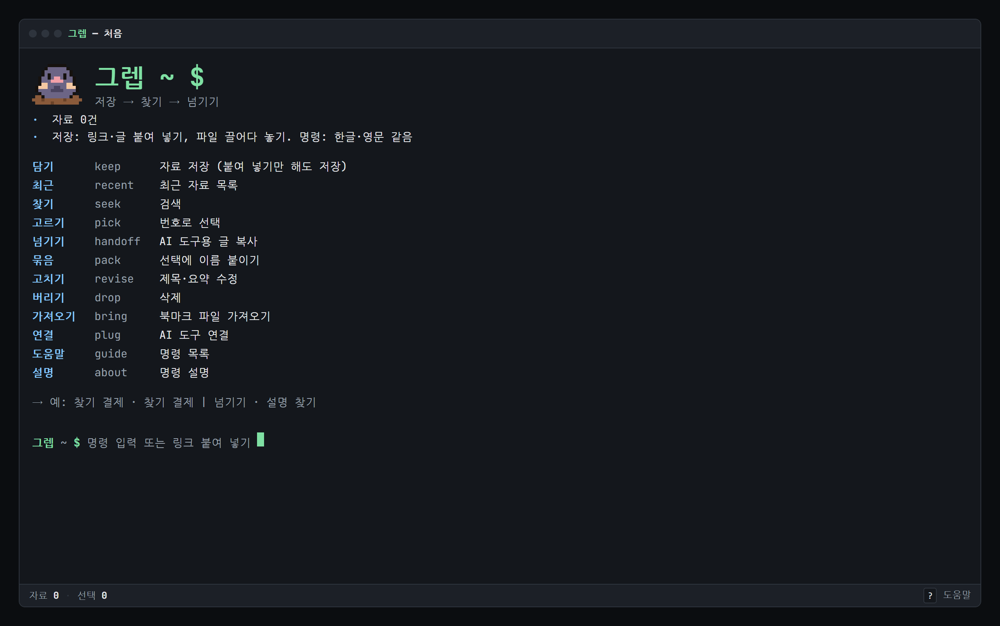

# grep (그렙)

[한국어](README.md) | English

Pick what you saved and copy it as text for any AI tool.

`keep` → `seek` → `pick` → `handoff`



## Usage

```text
그렙 ~ $ seek 결제
  131  결제위젯 연동 가이드         docs.tosspayments.com   2일 전
   97  PG사 수수료 비교 정리.pdf    PDF                     2주 전

그렙 ~ $ pick 131 97
✓ 선택 2건

그렙 ~ $ handoff
✓ 복사됨  2건 · 1,240자 (제목·출처·저장 시각·요약)
```

A terminal-style screen, not a real CLI. The screen text is Korean. Every command has a Korean name and an English alias that do the same thing. No command reuses an existing shell command name (`grep`, `ls`, `rm`, ...).

| English | Korean | Does |
|---|---|---|
| `keep` | `담기` | Save an item |
| `recent` | `최근` | List recent items |
| `seek` | `찾기` | Search |
| `pick` | `고르기` | Select by number |
| `handoff` | `넘기기` | Copy as text for an AI tool |
| `pack` | `묶음` | Name a selection |
| `guide` | `도움말` | List commands |

Full reference (Korean): [commands](docs/planning/commands.md)

## Demo scope (2026-12-01)

1. Save by paste or drag and drop, flag duplicates, generate a summary
2. Find again by keyword
3. Pick items and copy them as text for an AI tool

Success: find saved Korean items and paste them into an AI tool's input in under a minute.

## Not doing

- Does not recall forgotten items for you. It only shrinks what you must remember to one keyword.
- Does not solve company data restrictions. Items go to our server and an external LLM.
- Does not import items already saved in other apps, for now.
- Not a real CLI.
- The problem and its causes are still hypotheses. No interviews; a 12-person survey only shows direction.

## Stack

| Area | Choice | ADR |
|---|---|---|
| Server | Kotlin, Spring Boot, modular monolith | [BCK-003](docs/adr/backend/ADR-BCK-003-kotlin-spring-boot.md), [BCK-004](docs/adr/backend/ADR-BCK-004-modular-monolith-hexagonal.md) |
| Data, auth, files | Supabase | [BCK-006](docs/adr/backend/ADR-BCK-006-supabase-without-lock-in.md) |
| Web, desktop | React, shared Swift core, Tauri | [WEB-007](docs/adr/web/ADR-WEB-007-react-views-swift-core-tauri.md) |
| Summary | Small LLM on the server | [BCK-008](docs/adr/backend/ADR-BCK-008-server-small-llm-summary.md) |
| API | OpenAPI contract first | [ADR-0001](docs/adr/ADR-0001-api-contract-first.md) |

## Docs (Korean)

- [Planning at a glance](docs/planning/overview.md)
- [PRD](docs/planning/PRD.md)
- [Service policies](docs/policies/README.md)
- [ADR](docs/adr/README.md)
- [AI usage log](docs/ai-usage/README.md)
- [Docs map](docs/README.md)

## Team Unwrap

| Name | Role | GitHub |
|---|---|---|
| Taein Kim (김태인) | PO | [@delightPIP](https://github.com/delightPIP) |
| Kiseok Park (박기석) | Developer | [@carti1108](https://github.com/carti1108) |
