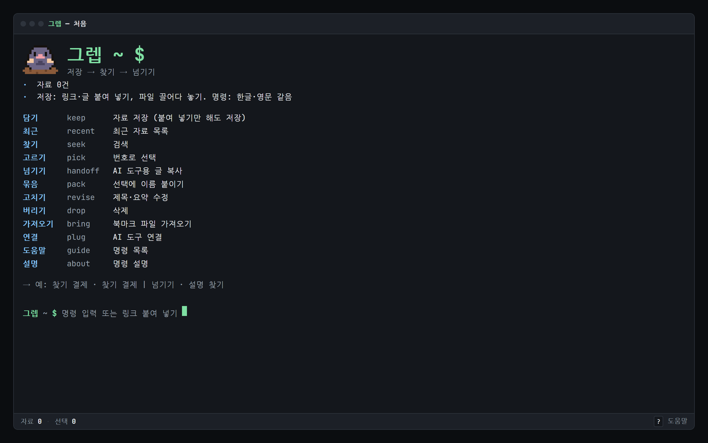

# 그렙

한국어 | [English](README.en.md)

저장한 자료를 골라 AI 도구용 글로 복사하는 서비스.

`담기` → `찾기` → `고르기` → `넘기기`



## 사용 예

```text
그렙 ~ $ 찾기 결제
  131  결제위젯 연동 가이드         docs.tosspayments.com   2일 전
   97  PG사 수수료 비교 정리.pdf    PDF                     2주 전

그렙 ~ $ 고르기 131 97
✓ 선택 2건

그렙 ~ $ 넘기기
✓ 복사됨  2건 · 1,240자 (제목·출처·저장 시각·요약)
```

터미널 느낌의 화면이다. 진짜 명령줄 도구가 아니다. 명령은 한글 기본, 영문판이 같은 일을 한다.

| 한글 | 영문 | 기능 |
|---|---|---|
| `담기` | `keep` | 자료 저장 |
| `최근` | `recent` | 최근 자료 목록 |
| `찾기` | `seek` | 검색 |
| `고르기` | `pick` | 번호로 선택 |
| `넘기기` | `handoff` | AI 도구용 글 복사 |
| `묶음` | `pack` | 선택에 이름 붙이기 |
| `도움말` | `guide` | 명령 목록 |

전체: [명령어 설명서](docs/planning/commands.md)

## 데모 범위 (2026-12-01)

1. 붙여 넣기·끌어다 놓기로 저장, 중복 알림, 요약 생성
2. 단어로 다시 찾기
3. 골라서 AI 도구용 글로 복사

성공 기준: 한국어 자료를 찾아 AI 도구 입력창에 붙여 넣기까지 1분 안.

## 스택

| 영역 | 선택 | ADR |
|---|---|---|
| 서버 | Kotlin, Spring Boot, 모듈러 모놀리스 | [BCK-003](docs/adr/backend/ADR-BCK-003-kotlin-spring-boot.md), [BCK-004](docs/adr/backend/ADR-BCK-004-modular-monolith-hexagonal.md) |
| 데이터·인증·파일 | Supabase | [BCK-006](docs/adr/backend/ADR-BCK-006-supabase-without-lock-in.md) |
| 웹·데스크톱 | React, Swift 공유 코어, Tauri | [WEB-007](docs/adr/web/ADR-WEB-007-react-views-swift-core-tauri.md) |
| 요약 | 서버 소형 LLM | [BCK-008](docs/adr/backend/ADR-BCK-008-server-small-llm-summary.md) |
| API | OpenAPI 계약 우선 | [ADR-0001](docs/adr/ADR-0001-api-contract-first.md) |

## 폴더

| 폴더 | 내용 |
|---|---|
| `api/openapi.yaml` | 클라이언트와 서버의 계약 원본(ADR-0001) |
| `server/` | Kotlin Spring Boot 서버(ADR-BCK-003·004) |
| `db/migrations/` | 순수 SQL 마이그레이션. 서버 빌드가 복사해 Flyway로 실행 |
| `core/` | Swift 공유 코어(ADR-WEB-007). 웹·iOS·Android가 같이 씀 |
| `web/` | 웹(Vite React + wasm 코어) |
| `ios/`, `android/` | 웹 다음에 만듦 |
| `docs/` | 정책·ADR·기획 문서([문서 지도](docs/README.md)) |

폴더 구성과 배포 방식은 [ADR-0010](docs/adr/ADR-0010-monorepo-top-level-folders.md), [ADR-0011](docs/adr/ADR-0011-free-tier-deploy-portable.md).

## 테스트

Docker가 켜져 있어야 한다(서버 테스트가 Postgres 컨테이너를 띄움).

```sh
cd server && ./gradlew test && cd ../core && swift test && cd ../web && npm test
```

환경변수는 `server/.env.example`, `web/.env.example`을 본다. `web`의 wasm 빌드는 macOS·Linux에서만 된다.

## 문서

- [기획 한눈에 보기](docs/planning/overview.md)
- [기획서 (PRD)](docs/planning/PRD.md)
- [서비스 정책](docs/policies/README.md)
- [ADR](docs/adr/README.md)
- [AI 활용 기록](docs/ai-usage/README.md)
- [문서 지도](docs/README.md)

## 팀 Unwrap

| 이름 | 역할 | GitHub |
|---|---|---|
| 김태인 | PO | [@delightPIP](https://github.com/delightPIP) |
| 박기석 | 개발 | [@carti1108](https://github.com/carti1108) |
