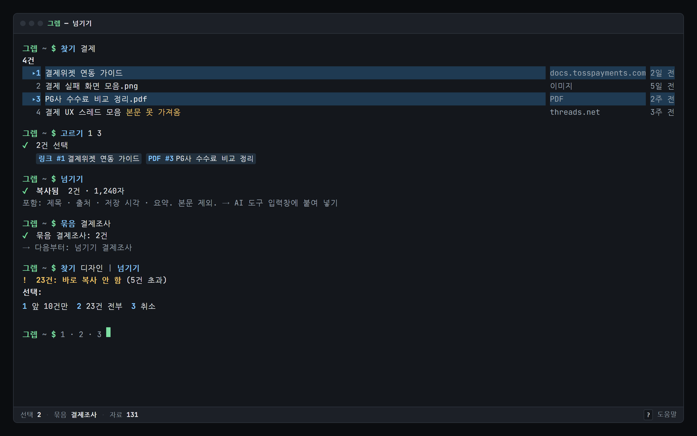
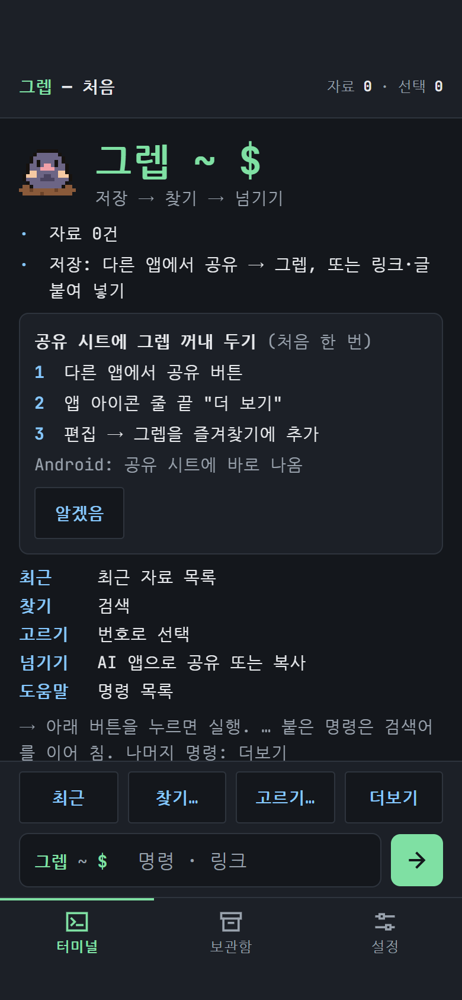

<div align="center">

# 그렙 ~ $

**Don't just store `|` grep and connect**

저장해 둔 링크·캡처·PDF를 한곳에 모으고,<br>
터미널 느낌의 화면에서 명령어로 골라 **AI 도구에 붙여 넣을 글**로 넘긴다.

`담기` → `찾기` → `고르기` → `넘기기`


</div>

## 왜 만드나

스레드, 유튜브, 북마크, 캡처. 저장은 열심히 하는데, 정작 AI에게 일을 시킬 때는 그 자료가 **여기저기 흩어져 있어 금방 모으지 못한다.** 그래서 자료 없이 묻거나, 하나씩 다시 찾아 붙여 넣는다.

그렙은 AI와 경쟁하지 않는다. 자료를 한 아카이브에 모아 두고, **내가 고른 자료만** 요약과 함께 어떤 AI 도구에든 넘긴다.

- AI가 무엇을 읽을지 내가 정한다. 저장함 전체를 열어 주지 않는다.
- 연결 설정도 요금제 조건도 없이, 지금 쓰는 AI 입력창에 바로 붙인다.

> 문제와 원인은 아직 가설이다. 근거와 한계는 [기획서](docs/planning/PRD.md)에 모두 밝혀 두었다.

## 이렇게 쓴다

```text
그렙 ~ $ 찾기 결제
  131  결제위젯 연동 가이드         docs.tosspayments.com   2일 전
   97  PG사 수수료 비교 정리.pdf    PDF                     2주 전

그렙 ~ $ 고르기 131 97
✓ 선택 2건

그렙 ~ $ 넘기기
✓ 복사됨  2건 · 1,240자 (제목·출처·저장 시각·요약)
· 클립보드에 있음 → AI 도구 입력창에 붙여 넣기
```

진짜 명령줄 도구가 아니라 **터미널 느낌의 화면**이다. 명령은 한글이 기본이고 같은 일을 하는 영문판이 있다. 기존 터미널 명령(`grep`, `ls`, `rm` …)과 겹치는 이름은 쓰지 않는다.

| 한글 | 영문 | 하는 일 |
|---|---|---|
| `담기` | `keep` | 자료 저장 (링크·글 붙여 넣기, 파일 끌어다 놓기는 명령 없이도 저장) |
| `최근` | `recent` | 최근 자료 목록 |
| `찾기` | `seek` | 검색 |
| `고르기` | `pick` | 번호로 선택 |
| `넘기기` | `handoff` | AI 도구용 글 복사 |
| `묶음` | `pack` | 선택에 이름 붙이기 |
| `도움말` | `guide` | 명령 목록 |

전체 명령과 화면 문구는 [명령어 설명서](docs/planning/commands.md)에 있다.

## 화면

<table>
<tr>
<td width="62%"></td>
<td width="38%"></td>
</tr>
<tr>
<td align="center"><sub>웹 · 고르고 넘기기</sub></td>
<td align="center"><sub>모바일 · 첫 화면</sub></td>
</tr>
</table>

마스코트는 땅을 파서 찾아오는 **두더지**다. 저장 중, 찾는 중, 넘기는 중마다 모습이 바뀐다.

## 12/1 데모에서 반드시 작동하는 것

| # | 흐름 | 명령 |
|---|---|---|
| 1 | 붙여 넣기·끌어다 놓기로 저장, 이미 저장한 자료면 알림, 요약 생성 | `담기` |
| 2 | 단어로 다시 찾기 | `찾기`, `최근` |
| 3 | 골라서 AI 도구에 붙여 넣을 글로 복사 | `고르기`, `넘기기` |

**성공 기준:** 저장해 둔 한국어 자료를 찾아 AI 도구 입력창에 붙여 넣기까지 **1분 안**.

## 기술 스택

| 영역 | 선택 | 결정 기록 |
|---|---|---|
| 서버 | Kotlin · Spring Boot, 기능별 모듈러 모놀리스 | [ADR-BCK-003](docs/adr/backend/ADR-BCK-003-kotlin-spring-boot.md), [ADR-BCK-004](docs/adr/backend/ADR-BCK-004-modular-monolith-hexagonal.md) |
| 데이터·인증·파일 | Supabase (전용 기능에 묶이지 않게) | [ADR-BCK-006](docs/adr/backend/ADR-BCK-006-supabase-without-lock-in.md) |
| 웹·데스크톱 | React 뷰 + Swift 공유 코어, 데스크톱은 Tauri | [ADR-WEB-007](docs/adr/web/ADR-WEB-007-react-views-swift-core-tauri.md) |
| 요약 | 서버의 소형 LLM | [ADR-BCK-008](docs/adr/backend/ADR-BCK-008-server-small-llm-summary.md) |
| API | OpenAPI 계약 먼저, 서버가 최종 판정 | [ADR-0001](docs/adr/ADR-0001-api-contract-first.md) |

첫 플랫폼은 웹이고, iOS·Android·데스크톱이 뒤를 잇는다. 운영은 무료 범위 안에서만 한다.

## 문서

| 문서 | 내용 |
|---|---|
| [기획 한눈에 보기](docs/planning/overview.md) | 문제, 대상, 해결을 한 장으로 |
| [기획서 (PRD)](docs/planning/PRD.md) | 문제·가설·지표·범위·데모 기준 |
| [명령어 설명서](docs/planning/commands.md) | 명령과 화면 문구 |
| [서비스 정책](docs/policies/README.md) | 동작·값·문구의 유일한 근거 |
| [설계 결정 (ADR)](docs/adr/README.md) | 왜 이 기술과 구조를 골랐는가 |
| [AI 활용 기록](docs/ai-usage/README.md) | AI와 함께 한 작업의 요청·판단·검증 |
| [문서 지도](docs/README.md) | 전체 문서 구조와 규칙 |

## 만든 사람

<div align="center">

**Team Unwrap** — *문제를 풀어 보다*

<table>
<tr>
<td align="center" width="200">
<a href="https://github.com/delightPIP"><br><b>김태인</b></a><br>
<sub>PO · 기획</sub><br>
<sub>문제 정의, 정책, 화면 문구, 발표</sub>
</td>
<td align="center" width="200">
<a href="https://github.com/carti1108"><br><b>박기석</b></a><br>
<sub>Developer · 개발</sub><br>
<sub>서버, 클라이언트, 기술 결정</sub>
</td>
</tr>
</table>

범위·정책은 PO가, 기술·구현은 개발자가 정한다.<br>
기획·디자인·문서 작업은 AI(Claude)와 함께 했고, 그 과정은 [AI 활용 기록](docs/ai-usage/README.md)에 모두 남겼다.

<sub>그렙 ~ $ 도움말 · 기획 → 개발 → 발표(2026.12.01)까지 하는 프로젝트다.</sub>

</div>
