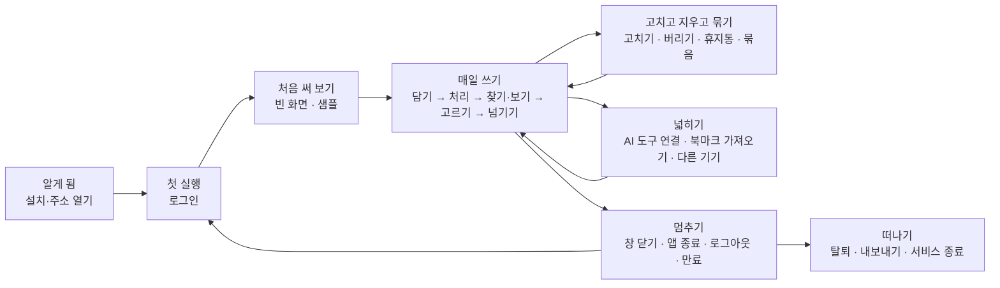

# 처음부터 끝까지 사용자 흐름과 빈칸

- 작성일: 2026-11-26
- 상태: 점검표. 새 결정은 없다. 지금 있는 문서·정책·시안만으로 사용자가 그렙을 시작해서 끝낼 때까지 무엇을 보는지 적고, 비어 있는 화면과 과정, 문서끼리 어긋난 곳을 뽑았다
- 대조한 것: [기획서](PRD.md) 0.8, [사용자 흐름도](user-flow.md), [명령어 설명서](commands.md), [데모 시드](demo-seed.md), [모바일·데스크톱 시안 문서](design-mobile-desktop.md), [플랫폼별 UI 학습 노트](platform-ui-study.md), [STATE](STATE.md) 용어 사전, [정책 전체](../policies/README.md)와 영역별 열린 질문, [그렙 웹 화면 시안](https://claude.ai/artifact/J6XT7UcSDvuPC2quoSsaRm) 화면 18개(웹 01~08, 모바일 M1~M5, 데스크톱 D1~D5)
- 점검 방법: 1차로 문서를 직접 따라간 뒤, 같은 날 다시 점검했다. 기획 빈칸 점검(필수 흐름·의미 충돌·결정 안 된 표기, 단계 센서 스크립트), 제품 설계 점검(도달 가능한 상태·되돌리기·오류·만료·오프라인), 정책 절차 점검, 결정 전파 점검(옛 표현 검색), 기획 비평 에이전트의 독립 검토(이 문서의 결론을 주지 않고 원문과 대조)를 거쳤다. 시안 캔버스에는 이 점검 뒤에 자세히 보기·보관함 화면(Detail, Archive, MobileArchive)이 다른 작업으로 올라왔다. 그 화면은 이 문서에서 검토하지 않았다

## 0. 읽는 법

플랫폼마다 사용자가 지나가는 차례대로 적었다. 단계마다 지금 얼마나 정해졌는지 붙였다.

| 표시 | 뜻 |
|---|---|
| ● | 화면 시안이 있다(시안 번호를 같이 적음) |
| ◐ | 글(정책·흐름도·설명서)로는 정했지만 시안이 없다 |
| ○ | 글도 시안도 없다. 정한 사람이 없다 |
| — | 두지 않기로 정했다 |
| [데모] | 12/1 발표에서 반드시 작동하거나 데모 장면에 나온다([흐름도](user-flow.md) 0절·11절, [데모 시드](demo-seed.md) 5절) |

플랫폼 순서는 개발 안을 따른다: 웹 → 반응형 모바일 웹·PWA → Windows 데스크톱(Tauri) → iOS 앱 → Android 다시 보기([학습 노트](platform-ui-study.md) 7.2절).

## 1. 한눈에: 사용자의 일생

| 단계 | 웹 | 모바일 웹·PWA | 데스크톱 | iOS 앱 |
|---|---|---|---|---|
| 알게 됨·설치 | ◐ 로그인 화면이 첫 화면(ACC-001) | ○ | ◐ | ○ |
| 첫 실행·로그인 | ◐ | ◐ | ◐ | ◐ |
| 처음 써 보기 | ● | ● | ○ | ● |
| 담기 | ● | ◐ | ● | ● |
| 처리(요약·글자 읽기) | ● | ● | ◐ | ◐ |
| 찾기 | ● | ● | ● | ● |
| 자료 하나 보기 | ◐ | ◐ | ◐ | ◐ |
| 보관함으로 훑어보기 | ◐ | ◐ | ◐ | ◐ |
| 고르기·넘기기 | ● | ● | ● | ● |
| 고치기 | ◐ | ◐ | ◐ | ◐ |
| 버리기·휴지통 | ◐ | ◐ | ◐ | ◐ |
| 묶음 | ◐ | ◐ | ◐ | ◐ |
| AI 도구 연결 | ◐ | ◐ | ◐ | ◐ |
| 북마크 가져오기 | ◐ | 해당 없음 | ○ | 해당 없음 |
| 설정 | ○ | ○ | ◐ | ○ |
| 멈추기(닫기·종료·로그아웃) | ◐ | ◐ | ◐ | ◐ |
| 떠나기(탈퇴) | — | — | — | — |

시안이 있는 것은 첫 화면과 "담기 → 찾기 → 넘기기" 줄기다. 들어오는 길(로그인), 나가는 길(로그아웃·만료), 자료를 들여다보거나 고치는 쪽(자세히 보기·`보관함`·`고치기`)은 글로만 있거나 비어 있다. 탈퇴는 프로젝트 기간에는 두지 않기로 했다(계정 열린 질문, PO 2026-11-26).

## 2. 웹 (첫 플랫폼)

### 2-1. 들어오기

1. ◐ 사용자가 그렙 주소를 받아 브라우저에서 연다. 소개 화면 없이 바로 로그인 화면이다. 로그인 전에는 로그인 화면만 보여 준다고 정했으므로(ACC-001 규칙 1, 예외 "데모도 로그인 화면에서 시작") 소개 화면을 두려면 ACC-001을 고쳐야 한다.
2. ◐ [데모] 로그인 화면: `그렙 ~ $ 로그인 필요`, `Google로 계속` · `GitHub로 계속`(ACC-001). **시안이 없다.** 데모 장면 0번이다.
3. ◐ Google·GitHub 창에서 허용한다. 취소하면 `✗ 로그인 취소됨`, 실패하면 `✗ 로그인 실패: <이유>`로 로그인 화면에 남는다. 처음이면 계정이 만들어진다. 약관 동의 화면은 두지 않는다(ACC-001 규칙 3).
4. 로그인 뒤 자료 수에 따라 갈린다.
   - ● [데모] 0건: 첫 화면(시안 01). 한 문장, 표어 `담기 → 찾기 → 넘기기`, `→ 샘플 8건으로 해 보기 또는 아래에 링크 붙여 넣기`, `· 명령 전체: 도움말`. 데모 장면 1이다.
   - ◐ [데모] 1건 이상: 남긴 터미널 기록이 없으면 상태줄 `자료 34 · 선택 0`과 입력줄만. `최근`은 사용자가 친다(COM-009, PO 결정 2026-11-26).

### 2-2. 처음 써 보기

5. ◐ `샘플 8건으로 해 보기`를 누르면 다음 번호부터 8개(새 계정은 1~8번)로 저장되고, 받은 번호 범위를 넣은 완료 줄과 `버리기 <a>-<b>` 안내, 이어서 `최근` 목록(ARC-010). 실패하면 `✗ 샘플을 넣지 못함. 다시 누르기`. 누른 뒤의 화면은 시안이 없다. 데모에서는 누르지 않는다(데모 시드 2절).
6. ● [데모] `도움말`은 자료가 0건이어도 전체 명령 13줄 표를 보인다. 세 명령만 보이는 것은 0건의 첫 화면뿐이다(설명서 3절 도움말, STATE 결정 로그 2026-11-26, PR #27). 시안 14 ①
7. ◐ 터미널에서 `폴더`·`mkdir`를 치면 `· 폴더 없음: 묶음이 폴더 역할  → 고르기 <번호> · 묶음 <이름>`(ARC-007). 시안 없음.

### 2-3. 담기

8. ● [데모] 링크나 글을 입력줄에 붙여 넣으면 저장된다. `✓ 저장됨  <제목> (<출처>)` 뒤에 `· 요약 생성 중`(시안 02).
9. ● [데모] 파일을 끌어다 놓으면 `놓으면 저장`, 놓으면 파일마다 한 줄(시안 02). 끌어 오는 중 안내는 `링크 · 글 · 이미지 · PDF · md · docx`(COM-004). 시안 02는 `여러 개 가능`으로 적혀 있다.
10. ● [데모] 같은 링크를 또 넣으면 `! 이미 저장됨 → 131번 (새로 만들지 않음)`과 그 자료, `→ 고르기 131`(시안 02, COM-001).
11. ◐ 휴지통에 있는 자료와 같으면 `! 휴지통에 있음 → N번. 되살리기 N`(ARC-008). 시안 없음.
12. ◐ 받지 않는 형식이면 `✗ 저장 못 함: 받지 않는 형식 (.zip)`(COM-004, 모든 플랫폼). 20MB가 넘는 파일의 문구만 없다.
13. ◐ 저장 실패: `✗ 저장 안 됨: <이유>  입력은 남겨 둠`, 이유는 `연결 끊김`·`응답 없음`·`서버 오류`(ARC-005). 시안 없음.

### 2-4. 처리 (사용자는 기다리지 않음)

14. ● [데모] 처리 중에는 회색 `· 요약 생성 중`, 상태줄 `요약 생성 중 N`(시안 02).
15. ● 본문을 못 가져오면 `! 본문 못 가져옴: 로그인 필요  제목·링크만 저장`과 `→ 본문은 글 붙여 넣기 또는 스크린샷으로`(시안 02). 목록에서는 `! 본문 못 가져옴 → 고치기 <번호>`(ARC-005).
16. ◐ 요약 실패 `! 요약 못 만듦  제목·출처만 넘김`, 하루 AI 처리 한도 `! 오늘 AI 처리 한도 초과. 저장됨, 요약 없음`(ARC-005, COM-005). 시안 없음.
17. ◐ [데모] 처리가 끝나면 이미 찍힌 `· 요약 생성 중` 줄이 그 자리에서 흐린 한 줄 요약으로 바뀌고, 새 줄은 찍지 않으며 상태줄 숫자가 줄어든다(ARC-005 규칙 10, PO 결정 2026-11-26).

### 2-5. 찾기

18. ● [데모] `찾기 <검색어>`: 두 줄 목록(번호·제목·출처·저장 시각 / 흐린 요약), 10건 넘으면 `23건 중 10건`과 `→ 더 보기`, 0건이면 `· 0건` 뒤에 최근 3건(시안 03, 06). `더 보기`를 쳐서 부르는 방법은 정하지 않았다(설명서 8절).
19. ◐ [데모] `최근`: 최근 10건. 데모의 "여러 출처 한 목록" 장면에서 글·링크·md·이미지·PDF가 섞이고 `! 본문 못 가져옴`이 한 줄 끼어 있다(데모 시드 5절). 목록 모양은 시안 03과 같지만 이 장면 자체는 그리지 않았다.
20. ◐ `찾기 #태그`, `최근 20`, 시점(`최근 지난달`, 주 구분선)은 설명서에만 있다.
21. ● 틀렸을 때: `✗ 없는 명령: 찻기`, `→ 찾기 결제?` 엔터로 실행, `grep` 받아 주기(시안 05).

### 2-6. 자료 하나 들여다보기

22. ◐ 목록의 자료 하나를 열어 요약 전체, 태그, 본문, 원본 이미지·PDF, 원래 링크를 보는 길이 명령으로는 없다(`도움말` 목록에 없음). 화면에 나올 일부는 정해져 있다: `AI 요약` / `요약 (직접 고침)` / `태그 (AI 추정)` 이름표(ARC-004), 태그 전부(ARC-002). 이 화면을 전제하는 곳은 ARC-004, 기획서 F2, 모바일 M3 줄 메뉴 `열기`, 데스크톱 로그 카드 "누르면 빠른 창을 열고 그 자료를 보여 준다"(DSK-002 규칙 7)다. 데모 장면에는 없다.

### 2-7. 고르기와 넘기기

23. ● [데모] `고르기 131 97` → `✓ 선택 2건`, 선택된 행 `▸`, 입력줄 위 선택 줄, `→ 넘기기 또는 묶음 <이름>`(시안 04).
24. ● [데모] `넘기기` → `✓ 복사됨  2건 · 1,240자`, 넘긴 자료 목록, 미리보기 펼치기, `· 클립보드에 있음 → AI 도구 입력창에 붙여 넣기`(시안 04).
25. ◐ [데모] 요약 없는 자료가 섞이면 `! 요약 없음 1건`(설명서 6절, 넘길 글 형식 3절). 시안 없음.
26. ● [데모] `찾기 … | 넘기기`: 5건 이하는 바로 복사, 6~10건은 `→ 전부: N건 전부 · 취소: 그 외 입력`, 11건 이상은 `앞10 · 전부`(COM-008, 시안 04는 23건 예). 데모 `찾기 텀블러 | 넘기기`는 8건이라 `전부`만 나온다. 확인 중 다른 걸 치면 `· 취소됨` 뒤 그 명령을 실행한다(COM-007).
27. ◐ [데모] 넘기기 실패: `✗ 복사 안 됨: <이유>  선택은 남겨 둠`, `→ 넘기기`. 이유가 `클립보드 거부`면 미리보기를 펼쳐 전체 선택하고 `→ 직접 복사: Ctrl+C · 다시: 넘기기`(COM-008). 시안 없음.
28. ○ 고른 것을 하나 빼거나 모두 푸는 명령이 웹에는 없다. 모바일은 칩의 `×`와 `모두 해제`로 뺀다(M3).
29. 그렙 밖: 사용자가 AI 도구 입력창에 붙여 넣는다.

### 2-8. 고치고 지우고 묶기

30. ◐ `고치기 131`: 제목·요약 수정, 직접 고친 요약은 자동 요약이 덮어쓰지 않음, 이름표 `요약 (직접 고침)`(ARC-004), 태그 지우기 `고치기 131 -#태그`(ARC-002). **편집하는 방식**만 비어 있다: 친 다음 무엇이 뜨는지, 저장·취소는 어떻게 하는지.
31. ◐ `버리기 131`: 1건은 확인 없이 휴지통, 2건 이상은 `버리기? N건 (휴지통으로)`, 번호 범위 `버리기 1-8`(ARC-008, ARC-010).
32. ◐ `휴지통`, `되살리기 <번호>`, `휴지통 비우기`(ARC-008). 명령 이름은 개발자 확인 대기다. 시안 없음. 휴지통 목록에 자료마다 남은 날을 보일지 정하지 않았다.
33. ◐ 묶음: `묶음`(목록), `묶음 <이름>`(넣기·보기), `빼기`, `지우기`, `넘기기 <이름>`(ARC-003, 흐름도 7절). 문구는 다 있고 시안이 없다. "되면 보여 줄 것" 1순위다.

### 2-9. 넓히기

34. ◐ AI 도구 연결: `연결` → 연결 주소와 안내, 연결 목록 → AI 도구에 주소를 넣음 → 그렙 승인 화면 `그렙 연결` / `허용 · 거부`(ARC-009) → 연결됨. `연결 끊기 <번호>`(ACC-002). 승인 화면, 연결 안내, 연결 목록 모두 시안이 없다. `연결`이 보여 줄 안내 문구, `거부` 뒤의 화면, 연결이 끊기거나 만료됐을 때 그렙 화면의 문구가 없다.
35. ◐ 북마크 가져오기: `가져오기` → 파일 끌어다 놓기 → 진행 건수 → `저장 N건 · 건너뜀 N건 · 실패 N건`(흐름도 10절). 한 번에 200건, 넘으면 `! 가져옴 200건 · 건너뜀 N건 (한 번에 200건)`(COM-005). 진행 중·결과 시안이 없다. 가져오는 동안 화면을 떠나도 계속되는지 정하지 않았다.
36. ○ 다른 기기에서 저장한 자료가 열어 둔 웹 화면에 언제 나타나는지(새로 고침해야 하는지, 저절로 들어오는지) 정하지 않았다(F6 동기화는 P1).

### 2-10. 설정

37. ○ 웹에는 설정 화면이 없다. 시안 06에 밝은 테마가 있지만 바꾸는 방법이 없다. 테마, 연결 목록, 로그아웃, 계정 정보(어느 계정으로 로그인했는지)를 어디서 보는지 없다. 모바일은 설정 탭을 두기로 했고(MOB-001) 넣을 항목은 "각 정책을 따른다"로만 남았다.

### 2-11. 멈추기와 떠나기

38. ◐ 새로 고침하거나 다시 열어도 출력 기록·치던 글·선택이 남는다. 로그아웃하거나 다른 계정으로 로그인하면 지운다. 로그인 만료 뒤 같은 계정이면 되살린다(COM-009, 모든 플랫폼).
39. ◐ [데모] `로그아웃` → `✓ 로그아웃됨` → 로그인 화면(ACC-001). 데모 장면 1-1(계정 A → B 전환)이다. `로그아웃 모든기기` → 확인 → `✓ 모든 기기 로그아웃됨`(ACC-002). 시안 없음.
40. ◐ 로그인 만료(30일 안 씀, 90일 지남): `! 로그인 만료 → 다시 로그인`, 치던 줄은 다시 로그인하면 돌아온다(ACC-001). 기다리던 확인은 취소된 것으로 본다(COM-007 규칙 7). 시안 없음.
41. ◐ 오프라인·서버 장애: 저장 실패의 이유 `연결 끊김`(ARC-005)은 있다. 찾기·넘기기가 안 될 때의 문구와, 화면 어디에 연결 상태를 보일지는 없다.
42. — 탈퇴는 프로젝트 기간에 두지 않는다. 자료 내보내기, 서비스 종료 고지는 실제 사용자를 받기 전에 정한다(10절 "범위 밖").

## 3. 모바일 웹·PWA (폭 600px 미만, 두 번째 플랫폼)

1. ○ 휴대폰 브라우저로 주소를 연다. 홈 화면에 추가(PWA 설치)를 안내할지 없다.
2. ◐ 로그인은 웹과 같다(ACC-001, 모든 플랫폼). 로그인 전에는 탭바가 없다(MOB-001 규칙 5). 모바일 모양의 시안은 없다.
3. ● 첫 화면: 배너 두더지, 명령 버튼 4칸(`최근 · 찾기… · 고르기… · 더보기`), 입력줄, 하단 탭(M1). M1은 웹 첫 화면과 달리 샘플 안내 대신 공유 시트 안내와 명령 다섯 줄을 보여 준다.
4. ● 입력창을 누르면 명령 격자, 키보드 동안 탭바 숨김(M2).
5. ○ 담기: 입력줄에 붙여 넣기는 된다. 공유 시트로 받기는 iOS 웹에서 안 되고 Android는 설치한 PWA만 된다(학습 노트 2.2절). 끌어다 놓기는 휴대폰에서 쓸 수 없다. 사진·PDF를 올리는 길(파일 고르기 버튼)이 없다.
6. ● 찾기 → 줄 눌러 고르기 → 고른 칩과 `공유 N건 · 복사 · 묶음…`(M3). 줄 메뉴 `버리기`는 1건이라 바로 휴지통으로 간다(M3, ARC-008).
7. ● 넘기기: OS 공유 시트(웹은 `navigator.share()`) 또는 복사, 5건 초과 선택지는 낱말(`앞10 · 전부`), 땅굴 두더지(M5).
8. ◐ 줄 메뉴 `열기`를 누른 뒤의 화면(2-6과 같은 빈칸).
9. ○ 줄 메뉴 `묶음…`을 눌렀을 때 이름을 받는 시트가 없다.
10. ◐ `보관함` 탭: 자동 묶음(형식·출처·날짜·태그), 내 묶음, 저장한 찾기로 나눠 보여 준다(ARC-007). 들어가서 묶음을 고르고 자료를 보는 흐름이 없다. 리스트인지 그리드인지는 학습 노트 7.3절 질문 6에 남아 있다. 저장한 찾기를 만드는 명령과 화면은 아무 데도 없다(ARC-007 비고).
11. ○ 설정 탭: 화면이 없다.
12. ◐ 다시 열면 늘 터미널 탭에서 시작하고(MOB-001 규칙 3), 그 탭의 기록은 남는다(COM-009).

## 4. Windows 데스크톱 두더지 (세 번째 플랫폼)

데스크톱 앱은 아직 기획서 기능 목록(F1~F22)에 없다(시안 문서 열린 질문 1).

1. ○ 설치 파일을 어디서 받는지, 설치 화면이 어떤지 없다. 정해진 것은 설치 화면에 `컴퓨터 켤 때 시작`(체크 켬)을 보여 준다는 것뿐이다(DSK-001 규칙 8).
2. ◐ 첫 실행 로그인: 로그인하지 않았으면 빠른 창에 로그인 안내를 보여 준다(DSK-003 규칙 7). 데스크톱 앱에서 Google·GitHub 로그인 창을 띄우고 앱으로 돌아오는 화면은 없다.
3. ● 상주: 오른쪽 아래 땅굴 띠와 두더지, 마우스를 올리면 자료 수와 단축키(D1).
4. ● 담기: 끌어 오면 만세, 놓으면 저장, 로그 카드 3초(D2, D3).
5. ◐ 받지 않는 형식이면 고개 흔들기와 `받지 않는 형식`, 연결 없음 `✗ 저장 못 함: 연결 없음`(DSK-002). 로그인하지 않은 채 두더지에 파일을 놓았을 때는 정하지 않았다.
6. ◐ 복사한 링크 알림(켰을 때만): `! 복사한 링크` / `담기?` / `담기 · 무시`, 8초(COM-003). 시안이 없다.
7. ● 빠른 창: 두더지를 누르거나 `Ctrl+Shift+G`, 웹과 같은 터미널(D4).
8. ◐ 트레이 우클릭 `1시간 숨기기 · 다시 보이기 · 설정 · 종료`(DSK-001). 시안 노트에 글로만 있다.
9. ◐ 설정 창: 단축키 바꾸기(DSK-003), 컴퓨터 켤 때 시작(DSK-001), 복사한 링크 알림 켜기(COM-003)가 여기 있다고 정책이 정했다. 화면이 없다.
10. ◐ 단축키 등록 실패 트레이 알림(DSK-003). 시안 없음.
11. ○ 트레이 `종료` 뒤 다음에 켤 때 로그인이 유지되는지, 앱 업데이트를 어떻게 받는지 없다.

## 5. iOS 앱 (네 번째 플랫폼)

1. ○ 앱 스토어 설치와 첫 실행이 없다. 로그인은 ACC-001을 따르고, 공유 확장이 앱과 로그인을 함께 쓴다(ADR-IOS-009). 로그인 화면 시안은 없다.
2. ● 첫 화면에 공유 시트에서 그렙을 꺼내 두는 안내(처음 한 번, M1).
3. ● 다른 앱에서 공유 → 그렙: 묻지 않고 저장, 2초 뒤 닫힘, 변형 네 가지(본문 옴, 링크만, 이미 저장 `→ 131번`, 여러 건)(M4).
4. ○ 앱에 로그인하지 않은 채 공유 시트에서 그렙을 고른 경우의 화면이 없다.
5. ○ 오프라인에서 공유하면 대기열에 넣었다가 올린다(ADR-IOS-009). "아직 안 올라감"을 어디에 보여 주는지, 끝내 실패하면 어떻게 알리는지 없다.
6. ● 찾기·고르기·넘기기는 모바일 웹과 같다(M3, M5).
7. ◐ `보관함` 탭, 설정 탭, 자료 하나 보기는 모바일 웹과 같은 빈칸이다.

## 6. AI 도구 쪽에서 본 흐름 (연결, P1)

1. ◐ 사용자가 AI 도구(Claude 등)의 연결 설정에 그렙 주소를 넣는다. 도구마다 넣는 곳이 다르다. 그렙의 `연결` 안내 문구가 없다.
2. ◐ 그렙 로그인 → 승인 화면 `그렙 연결` / `이 도구는 보관함 전체를 검색하고 읽을 수 있음(읽기 전용)…` / `허용 · 거부`(ARC-009). 이 화면은 그렙 웹이 그려야 하는데 시안이 없다. `거부` 뒤의 화면도 없다.
3. ◐ AI 작업 중 도구가 그렙을 검색(요약까지)하고 필요하면 읽는다(본문까지). 응답 맨 앞에 안내 줄이 붙는다(ARC-009).
4. ◐ 끊기: 그렙에서 `연결 끊기 <번호>` 또는 `로그아웃 모든기기`(ACC-002). 끊긴 뒤 AI 도구 쪽에서 사용자가 보는 것은 도구가 정한다.

## 7. 없는 화면

> 2026-11-26: 아래 화면은 모두 시안에 그렸고, 제안으로 그린 문구·동작 14묶음은 같은 날 PO가 시안대로 정했다(아래 8절 P6~P20 가운데 해당 항목 포함). 시안 번호와 확인 결과는 [플랫폼별 화면 체크리스트](screen-checklist.md)에 있다. 정책이 없어 문구·동작을 제안으로 그린 것은 그 문서 10절에 모았다.

여러 플랫폼에 같은 빈칸이 있으면 한 줄로 모았다. 우선순위는 제안이다. **발표 전**은 데모 장면이나 데모 필수 범위에 걸리는 것, **P1 시연**은 "되면 보여 줄 것"(묶음 → 글자 읽기 → 연결)에 걸리는 것, **발표 뒤**는 나머지다.

| # | 없는 화면 | 플랫폼 | 이미 정해진 것 | 우선순위 제안 |
|---|---|---|---|---|
| S1 | 로그인 화면(로그인 전, 취소·실패, 만료)과 `로그아웃` → 로그인 화면 전환 | 웹 | ACC-001 문구 전부 | 발표 전(데모 장면 0, 1-1) |
| S2 | 0건 화면의 `도움말` 출력(전체 13줄) | 웹 | 설명서 3절 | 발표 전(데모 장면 1) |
| S3 | 로그인 뒤 자료가 있을 때의 첫 화면(상태줄·입력줄만)과 `최근` 목록(여러 형식, `! 본문 못 가져옴` 섞임) | 웹 | COM-009, 데모 시드 5절 | 발표 전(데모 장면 1-1) |
| S4 | 요약 없는 자료가 섞인 넘기기 `! 요약 없음 1건`, 넘기기 실패·클립보드 거부, 6~10건 `전부` 확인과 `· 취소됨` | 웹 | 설명서 6절, COM-007, COM-008 | 발표 전 |
| S5 | 묶음(목록, 넣기, 묶음 안 보기, 넘기기 묶음) | 웹, 모바일 시트 | ARC-003 문구 전부 | P1 시연(1순위) |
| S6 | 연결 안내·연결 목록·승인 화면 | 웹 | ACC-002, ARC-009 문구 | P1 시연(3순위) |
| S7 | 자료 하나 보기(자세히 보기) | 모두 | ARC-004 이름표, ARC-002 태그. 이 점검 뒤 캔버스에 Detail 화면이 올라옴(검토 안 함) | 발표 뒤 |
| S8 | 샘플 8건 저장 직후와 저장 실패 | 웹 | ARC-010 문구 | 발표 뒤(데모에서 누르지 않음) |
| S9 | 휴지통(목록, 되살리기, 비우기 확인) | 웹, 모바일 | ARC-008 문구 | 발표 뒤 |
| S10 | `보관함`(자동 묶음, 묶음, 저장한 찾기) | 모바일 탭, 넓은 웹, 데스크톱 | ARC-007 규칙. 이 점검 뒤 캔버스에 Archive·MobileArchive 화면이 올라옴(검토 안 함) | 발표 뒤 |
| S11 | 설정 | 웹, 모바일 탭, 데스크톱 창 | MOB-001(탭), DSK-001·003·COM-003(항목) | 발표 뒤 |
| S12 | 넓은 웹(600px 이상) 배치: `보관함`·설정으로 가는 길 | 웹 | 학습 노트 3.3절의 추정안만 | 발표 뒤 |
| S13 | 북마크 가져오기 진행·결과 | 웹, 데스크톱 | 흐름도 10절, COM-005 | 발표 뒤 |
| S14 | 시점 찾기 결과(주 구분선) | 웹 | 설명서 문구 | 발표 뒤(F22 데모 여부 개발 답 대기) |
| S15 | 처리 실패·AI 한도 초과가 섞인 목록 | 모두 | ARC-005, COM-005 문구 | 발표 뒤 |
| S16 | 모바일 줄 메뉴의 묶음 이름 시트 | 모바일 | 없음 | 발표 뒤 |
| S17 | 데스크톱 설치·첫 로그인·설정 창·트레이 메뉴·복사 링크 알림 | 데스크톱 | DSK-001·003, COM-003 문구 | 발표 뒤 |
| S18 | iOS 설치·로그인, 로그인 안 된 공유 시트, 올리기 대기 표시 | iOS | ADR-IOS-009 구조 | 발표 뒤 |
| S19 | 오프라인·서버 장애 표시 | 모두 | ARC-005 `연결 끊김`, DSK-002 `연결 없음` | 발표 뒤 |

## 8. 없는 과정 (정한 사람이 없는 동작)

화면 이전에 "어떻게 움직이는가"가 비어 있는 것이다. 위의 화면을 그리려면 먼저 답이 있어야 한다.

| # | 없는 과정 | 우선순위 제안 | 왜 필요한가 | 누가 정할 일 |
|---|---|---|---|---|
| P1 | 처리가 끝난 걸 화면에 반영하는 방법 | 정함 | 그 자리에서 바꿈, 새 줄 없음 | ARC-005 규칙 10 (PO 2026-11-26) |
| P2 | 클립보드에 쓰지 못했을 때의 상태와 문구 | 정함 | 실패 줄과 선택 유지, 클립보드 거부면 직접 복사 안내 | COM-008 (PO 2026-11-26) |
| P3 | 5건 초과 10건 이하일 때의 선택지 | 정함 | 6~10건은 `전부`만 | COM-008 (PO 2026-11-26, PR #24와 같음) |
| P4 | 확인·선택 중 "그 외 입력" | 정함 | 취소 뒤 그 명령을 실행, 실행 답은 한글·영문 낱말 하나 | COM-007 (PO 2026-11-26) |
| P5 | 다시 열었을 때 출력 기록·치던 글·선택 | 정함 | 이 기기에 남김, 로그아웃·다른 계정이면 지움, 로그인 직후 빈 화면 | COM-009 (PO 2026-11-26) |
| P6 | 자료 하나를 여는 명령과 열었을 때 보여 줄 것(본문 전체, 원본 이미지·PDF, 원래 링크) | 발표 뒤 | ARC-004·F2·M3·DSK-002가 이 화면을 전제한다 | PO(내용), 명령 이름은 설명서 원칙대로 |
| P7 | `고치기`를 친 뒤 편집하는 방식과 저장·취소 | 발표 뒤 | `본문 못 가져옴 → 고치기` 안내가 여기로 보낸다 | PO(방식), 개발(구현) |
| P8 | 선택을 빼거나 모두 푸는 명령(웹) | 발표 뒤 | 고르기만 있고 되돌리기가 없다 | PO |
| P9 | 넘길 글이 길 때 고르는 방식과 문구, "길다"의 기준 | 발표 뒤 | 기획서 10절에만 있다 | PO(문구), 개발(기준값) |
| P10 | 20MB 넘는 파일의 문구 | 발표 뒤 | 받지 않는 형식(COM-004)만 문구가 있다 | PO |
| P11 | 다른 기기에서 저장한 자료가 열려 있는 화면에 들어오는 방식 | 발표 뒤 | F6(P1)이 생기면 부딪힌다 | 개발 |
| P12 | 모바일 웹에서 사진·PDF를 올리는 길 | 발표 뒤 | 끌어다 놓기를 못 쓰고 공유 시트는 iOS 웹에서 안 된다 | PO |
| P13 | 연결 안내 문구, 거부 뒤 화면, 연결이 끊기거나 만료됐을 때 그렙 화면의 문구 | P1 시연 | 기획서 10절 "끊겼다고 나온다"만 있다 | PO |
| P14 | 설정에 들어갈 항목의 목록(플랫폼별) | 발표 뒤 | 여러 정책이 "설정에서"라고 가리킨다 | PO |
| P15 | 찾기·넘기기가 안 될 때의 문구와 연결 상태 표시 위치 | 발표 뒤 | 저장 실패 이유만 있다 | PO |
| P16 | 저장한 찾기를 만드는 명령과 화면 | 발표 뒤 | ARC-007이 `보관함`의 한 축으로 둔다 | PO |
| P17 | 휴지통 목록에 남은 날을 보일지 | 발표 뒤 | 30일 뒤 저절로 영구 삭제된다. 미리 알 길이 없다 | PO |
| P18 | 로그인하지 않은 채 두더지에 놓기, 로그인 안 된 공유 시트 | 발표 뒤 | DSK-002·ADR-IOS-009에 없다 | PO |
| P19 | 북마크 가져오는 동안 화면을 떠나도 계속되는지 | 발표 뒤 | 진행 건수 표시만 있다 | 개발 |
| P20 | PWA 설치 안내, 데스크톱 설치 파일 배포, iOS 첫 실행 | 발표 뒤 | 플랫폼 순서상 다음 단계 | 개발(배포), PO(안내 문구) |

## 9. 문서끼리 어긋난 것

### 9-1. 이번 점검에서 고친 것 (2026-11-26)

정책이 먼저 정했고 다른 문서·시안이 따라가지 못한 것이다. 정책을 기준으로 맞췄다.

| # | 어디 | 어긋남 | 고친 것 |
|---|---|---|---|
| X1 | 시안 05·07, 모바일 M3 | `버리기` 1건에 확인을 받고 `(되돌릴 수 없음)`, M3는 `→ 1 삭제 · 2 취소`. ARC-008은 1건은 바로 휴지통, 30일 안에 되살릴 수 있다 | 05는 2건 확인 `버리기? 2건 (휴지통으로)`, 07·M3는 바로 `휴지통 1건`. 07의 `버리기` 설명도 휴지통으로 |
| X2 | COM-003 | 알림 버튼이 `1 담기 · 2 무시`(숫자 선택지). 설명서 6절은 확인 답을 숫자로 받지 않는다 | `담기 · 무시`로 바꾸고 이력·변경 이력에 적음 |
| X3 | 북마크 한 번 가져오기 상한 | 흐름도 10절과 공통 열린 질문이 2,000건, COM-005는 200건 | 흐름도와 열린 질문을 200건(COM-005)으로 |
| X4 | 설명서 2절 명령 표 | 휴지통 명령이 ARC-008에는 있고 표에는 없음 | 표에 세 줄 더함(이름은 개발자 확인 대기로 표시). `도움말` 화면에는 확인 뒤 더함 |
| X5 | 모바일 M2·M3, 데스크톱 D4·D5 | 상태줄은 `자료 131`인데 목록 번호가 1~4. 자료 번호는 사용자별 고유 번호다(ARC-001) | 131·118·97·64 같은 고유 번호로 |
| X6 | 모바일 M5 | 5건 초과 선택지가 `1 앞 10건만 · 2 23건 전부 · 3 취소`. 숫자 선택지는 자료 번호와 헷갈려 쓰지 않는다(설명서 4절) | `앞10 · 전부 · 취소: 그 외 입력` |
| X7 | 모바일 M1 | 표어가 `저장 → 찾기 → 넘기기`. 웹과 설명서는 `담기 → 찾기 → 넘기기` | `담기 → 찾기 → 넘기기` |
| X8 | 모바일 M4 | 이미 저장 문구가 `→ 기존 자료`. COM-001은 번호를 알린다 | `→ 131번 (새로 만들지 않음)` |
| X9 | 흐름도 3절·12절 | 받지 않는 형식의 문구를 비워 두고 `✗ 저장 안 됨`으로 적음. COM-004가 `✗ 저장 못 함: 받지 않는 형식 (.zip)`으로 정했다 | COM-004 문구로. 빈칸은 크기 초과 문구만 남김 |
| X10 | 흐름도 3절, 설명서 6절 | 끌어 오기 안내가 `링크 · 글 · 이미지 · PDF`. COM-004는 `… · md · docx`까지 | COM-004 문구로 |
| X11 | 설명서 `고치기`, 흐름도 8절 | "태그는 고치지 않음"만 있음. ARC-002는 `고치기 <번호> -#태그`로 지우기를 둔다 | 사용법과 흐름도에 태그 지우기를 더함 |
| X12 | ARC-001 비고 | "번호 범위 입력은 두지 않는다". ARC-010(PO 결정)과 설명서는 `버리기 1-8`을 쓴다 | ARC-001 비고를 "범위 입력은 `버리기`에만"으로 맞추고 이력·변경 이력에 적음 |
| X14 | 설명서 6절 두 줄과 흐름도 2절 | 명령 칩을 누르면 바로 실행인지 입력줄에 찍히기만 하는지 엇갈림 | PR #24의 PO 결정으로 정리됨: 명령 칩·번호는 찍히기만 하고 엔터로 실행 |
| X16 | 흐름도 11절 1-1과 데모 시드 5절 | 로그인 뒤 첫 화면이 `최근` 목록 대 상태줄만 | COM-009(P5)로 데모 시드 쪽에 맞추고 흐름도를 고침 |

### 9-2. 남은 것 (결정이 필요함)

| # | 어디 | 어긋남 | 누가 정할 일 |
|---|---|---|---|
| X13 | 시안 13장(웹 02~05·07, 모바일 M2~M5, 데스크톱 D2·D3·D4·D5)의 예시 자료 | 결제 위젯·PG사 이야기. 데모 이야기는 마케터의 겨울 텀블러 캠페인으로 바뀌었다(PO 2026-11-26, [데모 시드](demo-seed.md)). 열려 있는 PR(디자인 첨삭 요청 프롬프트와 시안 캡처 18장)이 이 시안을 찍어 두었으므로 바꾸면 그 캡처가 낡는다 | PO(언제 바꿀지) |
| X15 | STATE 용어 사전과 정책 | 사전은 "보관함"을 아카이브의 쓰지 않을 말로 두었는데 ARC-007·MOB-001은 화면·탭 이름으로 확정했다. 사전의 "묶음"은 "넘기려고 고른 자료의 모음"인데 ARC-003의 묶음은 이름 붙인 폴더 역할이고, 기획서 F4(P0) "찾은 자료로 묶음을 만들고"도 옛 뜻으로 읽힌다. 지금 고른 자료는 "선택"이다 | PO(사전 갱신) |
| X17 | 정책 문구 | 저장이 안 될 때 `✗ 저장 안 됨: <이유>`(ARC-005)와 `✗ 저장 못 함: <이유>`(COM-004, DSK-002) 두 꼴이 있다 | PO(하나로 할지) |
| X18 | DSK-001 마우스 올림 문구와 모바일 M3 | `누르기 열기`는 빠른 창을 여는 것, M3 `열기`는 자료 하나를 여는 것. 같은 낱말이 두 뜻이다 | PO(P6과 함께) |
| X19 | ARC-004 고정 문장 | `AI 요약은 … 원문과 다를 수 있다`. 사전은 "본문"을 쓰고 "원문"과 섞지 말라고 한다 | PO(경미) |

## 10. 범위 밖 (실사용자 전)

프로젝트는 발표까지이고 실사용자를 받지 않는다. 아래는 빈칸이지만 우선순위 목록에 넣지 않는다.

- 탈퇴(프로젝트 기간에는 두지 않음, PO 2026-11-26), 자료 내보내기, 서비스 종료 고지
- 개인정보 처리방침·약관·연령 제한·신고 창구·스토어 요구(공통·계정 열린 질문)
- 오래 쓰지 않는 계정 정리, 유료 전환 조건

## 11. 다음에 할 일 제안

1. ~~발표 전 과정 P1~P5를 PO가 정한다~~ → 2026-11-26 정함(ARC-005 규칙 10, COM-007~009).
2. 그 답으로 발표 전 화면 S1~S4를 그린다.
3. 남은 어긋남 X13(시안 예시 이야기)을 정한다. 열린 PR의 캡처와 순서를 맞춘다.
4. P1 시연 화면(S5 묶음, S6 연결)을 그린다.
5. 나머지는 발표 뒤 플랫폼 순서대로 한다.
