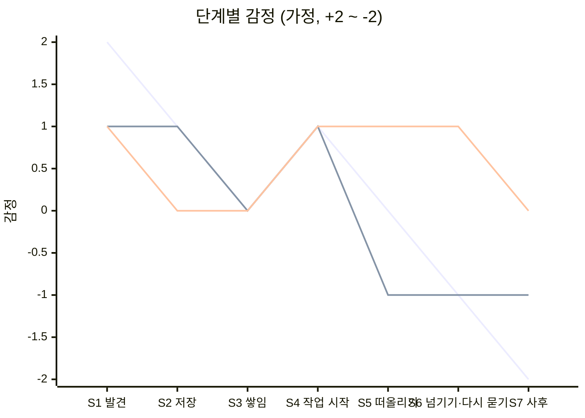

# 사용자 저니맵

작성일 2026-11-25. PO가 서술한 사용자("이것저것 알고 싶고 많은 것을 활용하고 싶은 사람")를 출발점으로, 자료를 발견해서 AI 작업에 쓰기까지의 흐름을 그렸다. 문제와 용어는 [기획 상태 문서](STATE.md)를 따른다. 같은 내용을 발표용 슬라이드로도 만들었다.

> **주의** 세 인물은 모두 가상이다. 인터뷰 전이라 생각·감정 칸은 [가정]이다. 이 문서의 목적은 인터뷰에서 확인할 순간을 고르고, 고정된 솔루션(저장해 아카이브에 모으고 AI 도구에 넘긴다)을 그 순간에 맞춰 구체화하는 것이다.

태그: [근거] 원문을 확인한 자료로 뒷받침 / [가정] 페르소나 설정이나 PO 서술 / [검증] 인터뷰·일지·직접 사용으로 확인해야 함. 감정은 +2(매우 좋음)부터 -2(매우 나쁨)까지다.

## 1. 출발점: PO가 서술한 사용자

- 이것저것 알고 싶은 게 많고, 본 것을 많이 활용하고 싶어 한다.
- SNS, 유튜브, 웹 등에서 본 것 가운데 적용해 보고 싶거나 프로젝트에 쓰고 싶은 것을 저장한다.
- 막상 프로젝트에 적용하거나 Claude에 요청할 때는 저장한 자료를 쓰지 못한다.
- 저장한 자료를 써야겠다는 생각 자체를 잊고, 같은 질문을 다시 하거나 같은 검색을 다시 한다.

마지막 항목은 지금까지 정리한 원인 어디에도 없다. 자료를 못 찾거나 넘기기 번거로운 게 아니라, 그보다 앞에서 **떠올리지 못해서** 시도조차 하지 않는다. 이 문서에서는 이것을 새 원인 후보 N7로 제안한다(7절).

## 2. 인물 (가상)

| ID | 인물 | AI 사용 | 저장 수단 | 유형 |
|---|---|---|---|---|
| P-A | 서윤, 29세, 핀테크 스타트업 PM. 주말에 Claude로 뉴스레터 웹사이트를 만들고 있다. 새 AI 도구, 디자인 레퍼런스, 프롬프트 팁을 보면 일단 저장한다 | Claude 대화를 매일 쓴다. AI 코딩 도구는 써 보기 시작했다 | 유튜브 나중에 볼 동영상, 스레드 저장, 크롬 북마크, 카톡 나에게 보내기, 사진첩 스크린샷 (5곳) | 입문 사용자, PO 서술의 주인공 |
| P-B | 민재, 33세, 백엔드 개발자. 사이드 프로젝트를 Claude Code로 만든다 | Claude Code를 매일 쓴다. 연결(MCP) 설정을 해 봤다 | GitHub 별표, X·스레드 북마크, Notion, Raindrop (4곳) | 숙련 사용자, 비교용 |
| R-1 | 하린, 30세, 프로덕트 디자이너. 레퍼런스 이미지와 PDF를 Claude 프로젝트에 올려 두고 쓴다 | Claude 프로젝트를 작업별로 만든다 | Claude 프로젝트, 핀터레스트 (2곳) | 반례: AI 도구 안에 이미 모아 둔 사람(STATE 5-1) |

저장 수단을 여러 개 함께 쓴다는 설정은 해외·국내 자료와 맞는다 [근거: E-05 주 1회 이상 평균 약 5가지 보관 방법, E-06 국내 비표본 약 3개 노트 앱 병행]. 개별 인물의 구성은 [가정]이다.

## 3. 공통 단계

모든 인물에 같은 7단계를 쓴다.

| 단계 | 이름 | 무슨 일이 일어나나 |
|---|---|---|
| S1 | 발견 | 피드나 검색에서 쓸 만한 것을 본다 |
| S2 | 저장 | 그 자리에서 손에 닿는 저장 수단에 넣는다 |
| S3 | 쌓임 | 며칠에서 몇 주 동안 다시 열지 않는다 |
| S4 | 작업 시작 | 프로젝트에서 AI 도구에 일을 시키려 한다 |
| S5 | 떠올리기 | 저장해 둔 자료가 생각나는가 (갈림길) |
| S6 | 넘기기 또는 다시 묻기 | 자료를 찾아 넘기거나, 자료 없이 묻거나 다시 검색한다 |
| S7 | 사후 | 결과물에 자료가 반영됐는가, 같은 것을 다시 저장하는가 |

## 4. 인물별 저니맵

### P-A 서윤 (주인공)

| 단계 | 행동 | 접점 | 생각 [가정] | 감정 | 페인포인트 | 근거·검증 |
|---|---|---|---|---|---|---|
| S1 발견 | 출근길에 스레드에서 "Claude로 랜딩페이지 만드는 프롬프트 5개" 글을 보고, 점심에 유튜브에서 "뉴스레터 디자인 잘한 사례 10개" 영상을 본다 | 스레드, 유튜브 | "이거 내 뉴스레터 사이트에 딱이다" | +2 | 없음 | [가정] PO 서술 |
| S2 저장 | 스레드 글은 저장, 유튜브 영상은 "나중에 볼 동영상"에 추가, 퇴근 후 웹 검색에서 찾은 글은 크롬 북마크. 영상 속 마음에 든 화면은 스크린샷 | 각 앱의 저장 버튼, 사진첩 | "저장해 뒀으니 나중에 쓰면 되지" | +1 | 저장 위치가 그때그때 다르다. 왜 저장했는지는 남지 않는다 | [근거: E-05, E-06 여러 수단 병행] [가정] 저장 이유가 남지 않음 |
| S3 쌓임 | 2주 동안 열어 보지 않는다. 그 사이 비슷한 글을 몇 개 더 저장한다 | 없음 | (생각하지 않음) | 0 | 저장했다는 사실이 기억에서 흐려진다 | [근거: E-19 해외 36명 전원이 다시 찾는 데 필요한 세부를 잊은 경험] [검증] 국내 대상 |
| S4 작업 시작 | 주말에 Claude를 열고 "뉴스레터 구독 페이지 만들어 줘"라고 쓰기 시작한다 | Claude 대화창 | "오늘은 구독 페이지까지 끝내자" | +1 | 없음 | [가정] |
| S5 떠올리기 | 저장한 프롬프트 글과 디자인 레퍼런스가 떠오르지 않는다 | 없음 | (떠오르지 않으므로 생각도 없음) | 0 | **잊었다는 것을 본인도 모른다.** 이 순간에는 불편이 없다 | [가정] PO 서술 "생각 자체를 잊음" [검증] 일지로만 잴 수 있음 |
| S6 다시 묻기 | 자료 없이 묻는다. 결과가 평범해서 "요즘 뜨는 뉴스레터 디자인"을 다시 검색한다 | Claude, 웹 검색 | "왜 이렇게 밋밋하지" | -1 | 같은 질문, 같은 검색을 반복한다. 결과물에 저장한 자료가 반영되지 않는다 | [가정] PO 서술 [참고: E-18 웹 검색어의 최대 40%가 다시 찾기일 수 있으나 저장한 자료인지는 모름] |
| S7 사후 | 며칠 뒤 유튜브 "나중에 볼 동영상"을 넘기다 그 영상을 발견한다. 이미 구독 페이지는 만들었다 | 유튜브 | "아, 이거 저장해 놨었는데" | -2 | 뒤늦게 알아챈다. 같은 자료를 또 저장하기도 한다 | [가정] [검증] 인터뷰에서 "아차" 사례 수집 |

### P-B 민재 (숙련 사용자, 비교)

| 단계 | 행동 | 접점 | 생각 [가정] | 감정 | 페인포인트 | 근거·검증 |
|---|---|---|---|---|---|---|
| S1 발견 | X에서 인증 라이브러리 비교 글, GitHub에서 예제 저장소를 본다 | X, GitHub | "다음에 인증 붙일 때 참고하자" | +1 | 없음 | [가정] |
| S2 저장 | 글은 Raindrop, 저장소는 GitHub 별표, 짧은 팁은 Notion에 붙여 넣는다 | Raindrop, GitHub, Notion | "태그 달아 뒀으니 찾을 수 있다" | +1 | 자료 종류마다 저장 수단이 다르다 | [근거: E-05] [가정] |
| S3 쌓임 | 한 달 뒤까지 열지 않는다 | 없음 | — | 0 | 없음 | [가정] |
| S4 작업 시작 | Claude Code로 로그인 기능을 붙이기 시작한다 | Claude Code | "인증은 전에 봐 둔 게 있었지" | +1 | 없음 | [가정] |
| S5 떠올리기 | 저장한 건 떠오르지만 어디에 넣었는지 헷갈린다 | Raindrop, Notion 검색 | "Raindrop이었나 Notion이었나" | -1 | 떠올렸지만 찾는 데 시간이 든다(N1, N2) | [근거: E-19 매주 이상 72%] [검증] |
| S6 넘기기 또는 다시 묻기 | 5분 찾다가 포기하고 Claude Code에 "Next.js 인증 라이브러리 추천해 줘"라고 다시 묻는다 | Claude Code | "그냥 물어보는 게 빠르다" | -1 | 저장한 비교 글이 반영되지 않는다 | [가정] [검증] 일지 |
| S7 사후 | Raindrop의 연결(MCP)을 걸어 둘까 생각하지만, 저장 수단마다 따로 연결해야 해서 미룬다 | Raindrop 설정 | "다 연결하기는 귀찮다" | -1 | 연결은 저장 수단마다 따로다 | [근거: 경쟁 서비스 조사, 저장 수단 하나를 AI 도구에 연결하는 서비스 12곳] |

### R-1 하린 (반례: AI 도구 안에 이미 모아 둔 사람)

| 단계 | 행동 | 접점 | 생각 [가정] | 감정 | 페인포인트 | 근거·검증 |
|---|---|---|---|---|---|---|
| S1 발견 | 핀터레스트와 디자인 블로그에서 온보딩 화면 레퍼런스를 본다 | 핀터레스트, 웹 | "이번 온보딩 개편에 쓰자" | +1 | 없음 | [가정] |
| S2 저장 | 이미지를 내려받아 작업별 Claude 프로젝트에 바로 올린다 | Claude 프로젝트 | "작업할 때 여기서 바로 쓴다" | 0 | 올리는 수고가 저장 때 든다 | [근거: Claude 프로젝트 기능 존재, 경쟁 서비스 조사] [가정] |
| S3 쌓임 | 프로젝트 안에 자료가 쌓인다 | Claude 프로젝트 | — | 0 | 없음 | [가정] |
| S4 작업 시작 | 그 프로젝트를 열고 대화를 시작한다 | Claude 프로젝트 | — | +1 | 없음 | [가정] |
| S5 떠올리기 | 떠올릴 필요가 없다. 자료가 이미 프로젝트에 있다 | Claude 프로젝트 | — | +1 | 없음 | [가정] |
| S6 넘기기 | 따로 넘기지 않아도 Claude가 자료를 읽는다 | Claude | "레퍼런스 반영이 잘 된다" | +1 | 다른 AI 도구(예: 다른 회사 도구)로 옮기면 다시 올려야 한다(N5) | [근거: 다른 회사 AI 도구로 내보내는 기능을 찾지 못함, 경쟁 서비스 조사] |
| S7 사후 | 프로젝트 밖에서 저장한 것(핀터레스트 보드)은 여전히 쓰이지 않는다 | 핀터레스트 | — | 0 | 미리 올려 둔 것만 쓰인다 | [검증] 이런 사람이 얼마나 되는지 |

R-1은 S5의 "잊음"을 구조로 피한다. 작업 공간과 저장 공간이 같기 때문이다. 이 반례가 많으면 STATE 5-1 반증 조건 3에 걸린다.

## 5. 감정 곡선

선 순서: P-A 서윤, P-B 민재, R-1 하린.

읽는 법: 서윤의 감정은 S5에서 떨어지지 않는다. 잊었기 때문에 불편을 느끼지 못하고, 손해는 S7에 뒤늦게 온다. 민재는 S5에서 이미 떨어진다(떠올렸지만 찾지 못함). 하린은 저장 때(S2) 수고를 먼저 치르고 뒤에서 편하다.

## 6. 비교표

| 구분 | P-A 서윤 | P-B 민재 | R-1 하린 |
|---|---|---|---|
| 저장하는 계기 | 호기심. "언젠가 써 보고 싶다" | 다음 작업에 쓸 참고 | 지금 하는 작업 |
| 저장하는 곳과 일하는 곳의 거리 | 멀다(소셜 앱 ↔ Claude) | 중간(개발 도구 ↔ Claude Code) | 같다(Claude 프로젝트) |
| 떠올리기(S5)에서 생기는 일 | 떠오르지 않는다 | 떠오르지만 어디 뒀는지 모른다 | 떠올릴 필요가 없다 |
| 실패를 누가 아는가 | 아무도 모른다. 본인도 나중에 우연히 안다 | 본인이 그 자리에서 안다 | 해당 없음 |
| 손실 형태 | 같은 질문·같은 검색 반복, 결과물이 평범해짐, 같은 자료 다시 저장 | 찾는 시간, 결국 자료 없이 질문 | 저장할 때 올리는 수고, 다른 AI 도구로 옮기면 다시 올림 |
| “명령어로 직접 골라 넘기기”면 충분한가 | 아니다. 떠올려야 명령어를 치니 시작이 안 된다 | 맞다 | 대체로 충분하다. 다른 AI 도구로 옮길 때만 약하다 |

## 7. 새 원인 후보 N7: 못 찾는 게 아니라, 떠올리지 못한다

- **한 줄로:** AI에게 일을 시킬 때, 관련 자료를 저장해 둔 것 자체가 떠오르지 않아 넘기려는 시도조차 안 한다. (제안, PO 판단 전)
- **기존 원인과 다른 점:** 지금까지의 원인은 “흩어져 있다(N1)”, “못 찾는다(N2)”, “매번 다시 넣는다(N5)”였다. 모두 자료를 쓰려고 마음먹은 뒤의 문제다. N7은 그보다 앞에서 막힌다.
- **근거:** PO가 본 사용자 이야기와, 설문 첫 신호 하나다. 설문 응답 12명 중 6명이 지난 4주에 “저장해 둔 걸 모르고 다시 찾거나 다시 저장한” 일이 2번 이상 있었고 4명은 모르겠다고 답했다([설문 결과](survey-results.md), E-92). 다만 응답이 12개뿐이고 AI 작업 중이었는지는 묻지 않았다. 가장 가까운 연구(E-19)는 자료가 “어디 있는지, 무엇이었는지”를 잊는 것이라 “있다는 것” 자체를 잊는 것과 다르다.
- **이렇게 나오면 N7이 아니다:** 일지에서 “관련 자료가 있었는데 넣지 않고 물은” 경우를 모았을 때, 그때 자료를 떠올렸던 경우가 절반을 넘으면 원인은 N7이 아니라 N1·N2·N5다.
- **재는 방법:** 잊은 사람은 잊은 줄 모르니, 인터뷰에서 물어서는 잘 안 나온다. AI 작업이 끝날 때마다 저장 수단을 훑어보고 관련 자료가 있었는지 적는 일지로 잰다.

참고: 이전 문제 정의에서는 “저장한 걸 아예 잊는다”가 문제를 뒤집는 조건이었다(STATE 5-1 N2-2). 지금 문제 정의(AI에 넘기기)에서는 원인 후보가 된다. 또 PO는 예전에 해결 방향을 “저장한 자료를 아무 때나 다시 보여 주기”로 넓히는 것을 되돌렸다. 그래서 8절의 해결안은 모두 **AI에게 일을 시키는 순간에** 돕는 것으로 한정했다.

## 8. 서비스가 끼어들 순간

여정에서 서비스가 도와야 할 순간은 네 번이다. 괄호 안의 F 번호는 [기획서](PRD.md) 7절의 기능 번호이고, F20·F21은 이 문서에서 새로 낸 후보다.

| 순간 | 지금 (가정) | 서비스가 하는 일 | 기획서에 있나 |
|---|---|---|---|
| 저장할 때 | 앱마다 다른 곳에 저장한다 | SNS, 유튜브, 웹 등에서 공유 한 번으로 한 곳에 모은다. 내용 요약도 알아서 만든다 (F1, F2) | 있음 |
| Claude에 요청할 때 | 저장한 게 떠오르지 않는다 | 서비스가 먼저 알려 준다. 방법은 아래 세 가지 | 일부 있음 |
| 같은 걸 또 찾거나 또 저장할 때 | 같은 검색, 같은 저장을 반복한다 | “이미 저장됨”을 알리고 그 자료를 보여 준다 (F21) | 새 후보 |
| 대화를 새로 시작할 때 | 같은 자료를 다시 넣는다 | 자주 쓰는 자료 묶음에 이름을 붙여 두고 한 줄로 다시 넘긴다 (F12) | 있음 |

저장 방법: SNS, 유튜브, 웹 등의 자료는 링크 공유로 넘기거나 캡처 이미지로 넘긴다. 캡처 이미지는 글자를 읽어 검색되게 한다(F16).

### 8-1. Claude에 요청할 때, 자료가 먼저 나타날 세 곳

서윤은 저장한 걸 떠올리지 못하니 명령어를 칠 생각도 못 한다. 그러니 서비스가 먼저 알려 줘야 한다.

| 방법 | 어디서 | 서윤이 보는 것 (예) | 필요한 것·한계 |
|---|---|---|---|
| 1 | Claude 안에서 | Claude: “저장해 두신 뉴스레터 레퍼런스 3개를 참고했어요.” | Claude에 그렙을 처음 한 번 연결해 두어야 한다(MCP, F7). 기획서에서는 뒤로 미룬 기능이다 |
| 2 | 우리 앱에서 | `start 뉴스레터`를 치면 관련 자료 4개를 모아 붙여 넣을 글을 복사해 준다 | 우리 앱을 열 생각이 나야 한다. 그래서 잊음을 완전히 풀지는 못한다 (F20) |
| 3 | Claude 입력창 옆에서 | 질문을 쓰는 동안 옆에 “관련 저장 자료 3개 [넣기]”가 뜬다 | 브라우저 확장을 설치해야 한다. 나중 단계다. 비슷한 확장을 이미 내놓은 서비스가 있다 (F11) |

### 8-2. 제안: 기억날 때와 잊었을 때, 따로 돕는다

| 상황 | 누구 | 어떻게 돕나 |
|---|---|---|
| 기억날 때 | 민재 | 내가 명령어로 직접 찾아 골라서 Claude에 붙여 넣는다(`grep 인증 \| copy`). 지금 우리 차별점이다 |
| 잊었을 때 | 서윤 | 서비스가 대신 챙긴다. Claude가 답하기 전에 저장함을 먼저 찾아보고(방법 1), 같은 걸 또 저장하려 하면 이미 있다고 알려 준다 |

고민되는 점: 우리 차별점은 “내가 직접 고른다”다. 여기에 “Claude가 알아서 찾는다”를 같이 넣으면, 이미 그렇게 하는 다른 서비스와 비슷해 보일 수 있다. PO가 정한다(11절).

### 8-3. 같은 주말, 서비스가 있다면 (가정)

| 순간 | 지금 | 서비스가 있으면 |
|---|---|---|
| 저장할 때 | 앱마다 다른 곳에 저장한다 | 공유 한 번으로 한 곳에 모인다 |
| Claude에 요청할 때 | 저장한 게 떠오르지 않는다 | Claude가 저장함에서 레퍼런스 3개를 찾아 쓴다. 연결하지 않았다면 명령어 한 줄로 넘긴다 |
| 결과물 | 평범하다. 같은 검색을 또 한다 | 저장해 둔 레퍼런스가 반영된다 |
| 며칠 뒤 | “아, 저장해 놨었는데” | 같은 걸 또 저장하면 “이미 있어요” |

서윤이 마지막에 느끼는 기분은 −2에서 +1로 바뀐다(가정, 시제품으로 확인).

## 9. 확인할 것

인터뷰와 일지 연구는 하지 않기로 했다([기획 상태 문서](STATE.md) 12절). 추가 설문도 하지 않으므로 아래 항목은 이번 범위에서 확인하지 않고 발표에서 한계로 밝힌다. 4번만 마감한 설문(E-92)에 간접 신호가 있다.

1. 최근 AI 작업 가운데 “나중에 보니 관련 자료를 저장해 뒀던” 사례가 있는가 (서윤 유형, N7)
2. 그때 자료를 아예 떠올리지 못했는가, 떠올렸지만 못 찾았는가, 찾았지만 넣기 번거로웠는가 (원인 구분)
3. SNS, 유튜브, 웹 등에서 저장한 것 가운데 AI 작업에 쓰려던 것의 비중 (공백 14)
4. 같은 것을 다시 검색하거나 다시 저장한 경험과 빈도
5. Claude가 알아서 저장함을 찾아 쓰는 것과 내가 직접 골라 넘기는 것 가운데 무엇을 원하는가
6. 작업과 저장을 한 곳(Claude 프로젝트 등)에서 하는 사람이 얼마나 되는가 (R-1, 반증 조건 3)

## 10. 객관성의 한계

- 세 인물은 가상이다. 서윤은 PO 서술을, 민재와 하린은 기획 에이전트의 설정을 바탕으로 했다.
- 생각·감정은 모두 [가정]이고, 감정 점수는 상대 비교용이다.
- SNS·유튜브 저장 행동, 국내 AI 활용자의 저장 행동은 근거가 없다(STATE 13절 공백 4, 9, 14).
- 세 인물 모두 Claude 사용자로 그렸다. 다른 AI 도구 사용자는 다를 수 있다.
- 주인공 저니가 실패로 끝나도록 그렸으므로, 반례 R-1을 함께 두었다. 서윤 유형이 실제로 얼마나 되는지는 모른다.

## 11. PO 판단이 필요한 것

| 번호 | 항목 | 왜 |
|---|---|---|
| 1 | “떠올리지 못한다”(N7)를 원인 후보로 기획 상태 문서에 올릴지 | PO가 본 사용자에서 나왔고, 아직 다른 근거는 없다 |
| 2 | Claude에 요청할 때 자료가 먼저 나타날 세 곳(8-1절) 가운데 무엇을 개발자에게 MVP 후보로 넘길지 | 범위는 개발자가 정하지만 방향은 PO가 정한다 |
| 3 | “기억날 땐 직접 고르고, 잊었을 땐 서비스가 챙긴다”(8-2절)로 갈지 | “내가 직접 고른다”는 차별점이 흐려질 수 있다 |
| 4 | 작업 이름으로 자료 모으기(F20), 같은 걸 또 저장할 때 알림(F21)을 기획서 범위에 넣을지 | 새로 낸 후보다 |
