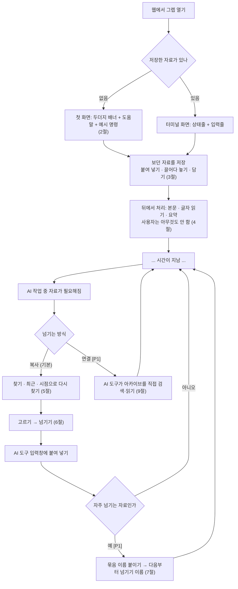
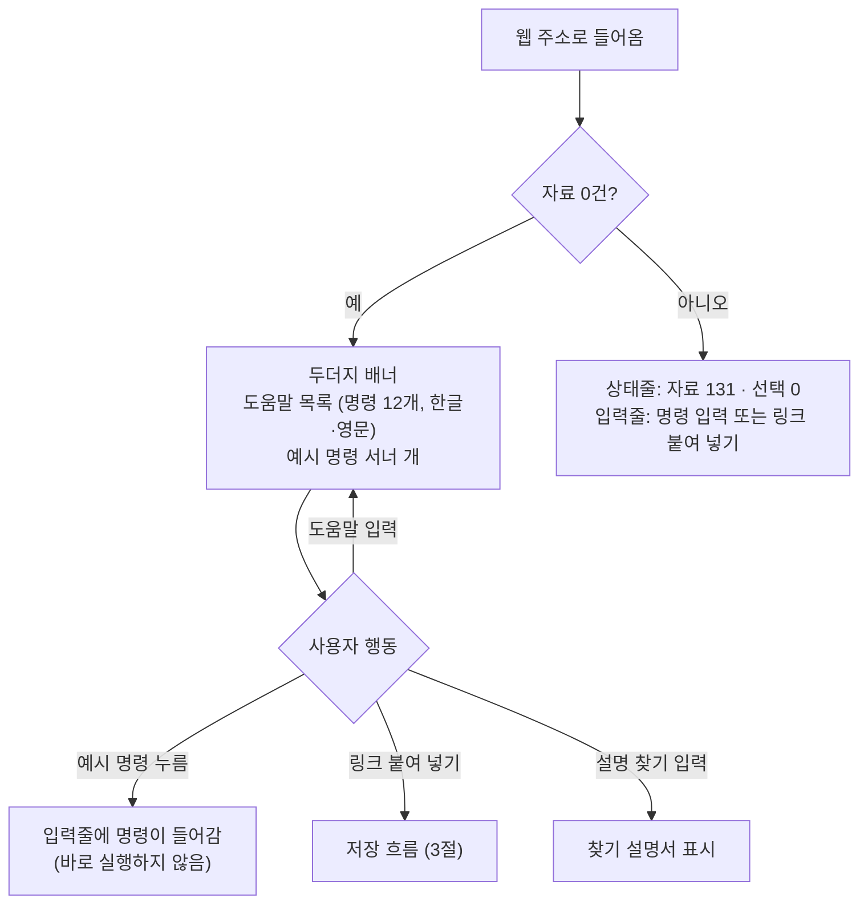
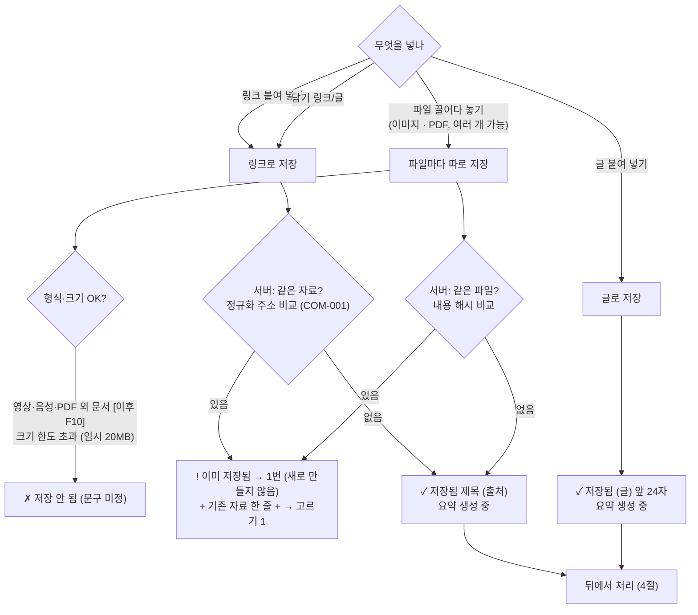
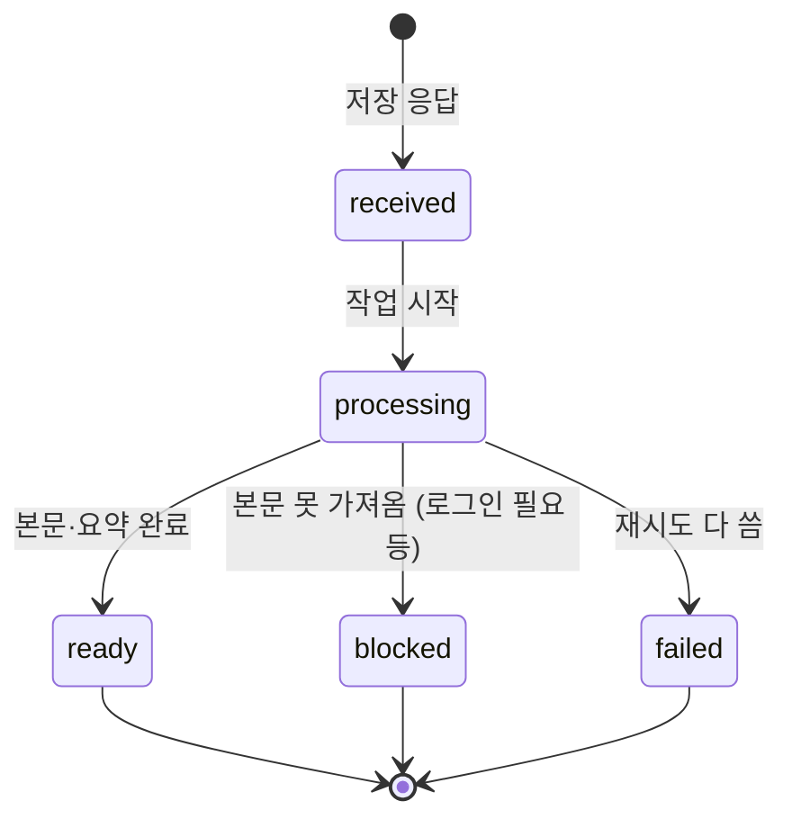
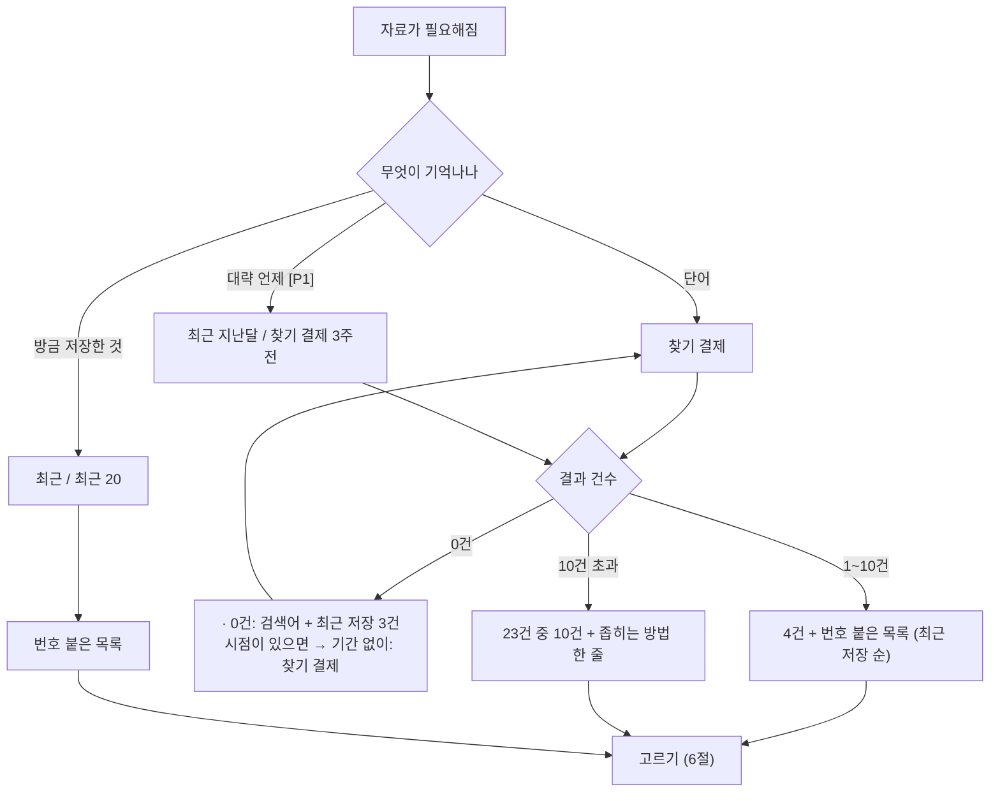
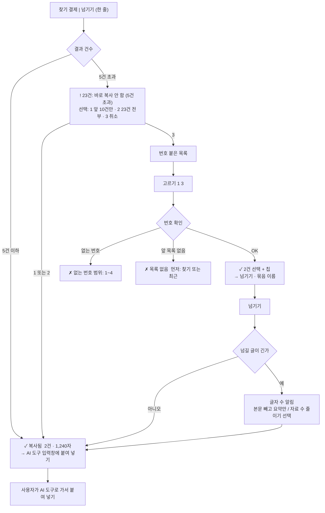
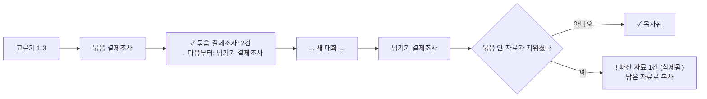
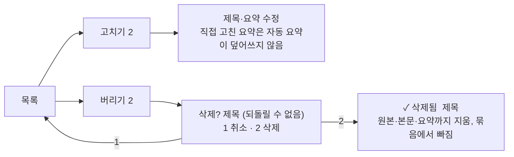
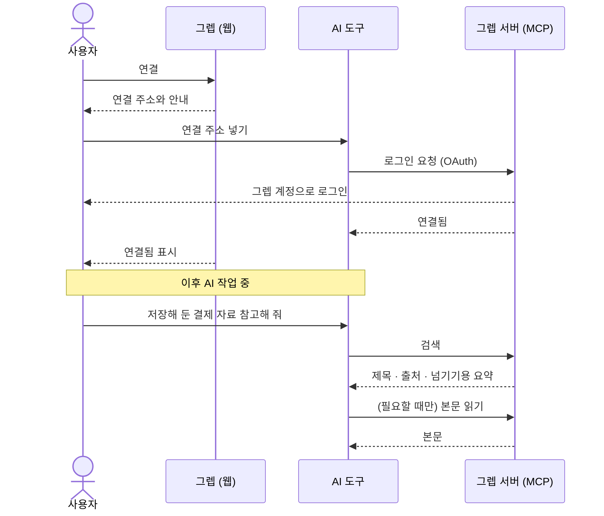
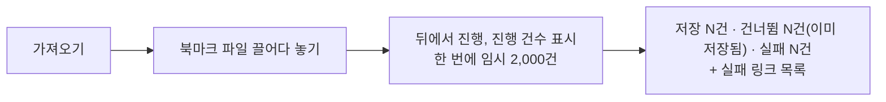

# 사용자 흐름도

- 작성일: 2026-11-25
- 상태: 제안. [기획서](PRD.md) 0.6, [명령어 설명서](commands.md), [백엔드 설계](backend-design.md), 정책 [COM-001](../policies/common/COM-001-same-link-detection.md)·[COM-002](../policies/common/COM-002-external-llm-data.md), AI 활용 기록 001~033을 대조해 정리했다
- 첫 플랫폼: 웹. 휴대폰 공유로 저장하기와 명령어 버튼(US-7)은 모바일 앱 단계다

기획서 9절의 다섯 단계 흐름을 화면·명령·분기 단위까지 풀어 쓴 문서다. 새 결정은 없다. 문서끼리 다르면 기획서가 우선이고, 문구는 명령어 설명서 6절이 우선이다.

## 0. 읽는 법

흐름마다 범위를 붙였다.

| 표시 | 뜻 |
|---|---|
| **[데모]** | 12/1 발표에서 반드시 작동(개발자가 11/29까지 보장). 저장·알림·요약, 찾기, 고르기·넘기기, 첫 화면 도움말 |
| [P0] | MVP 핵심 흐름에 필요 |
| [P1] | MVP에 넣되 뒤로 밀 수 있음. 데모에는 되면 보여 준다 |
| [이후] | 이번 MVP에 없음 |

문구는 화면에 나오는 그대로 `코드`로 적는다. 기호: `✓` 성공, `·` 안내, `!` 알림(실패 아님), `✗` 실패, `→` 다음에 칠 명령.

## 1. 전체 흐름 한눈에

핵심 흐름(데모 성공 기준): 저장해 둔 한국어 자료를 `찾기`로 찾아 AI 도구에 붙여 넣을 글로 복사하기까지 **1분 안**.

## 2. 처음 열 때 (F5) [데모]

| 단계 | 사용자 | 화면 | 근거 |
|---|---|---|---|
| 1 | 그렙을 처음 연다 | 두더지 배너, `도움말` 목록, 예시 명령. 맨 아래 `→ 예: 찾기 결제 \| 넘기기 · 자세히: 설명 찾기` | US-6, 시안 01 |
| 2 | 예시 명령을 누른다 | 입력줄에 명령이 들어간다. 사용자가 Enter로 실행한다 | US-6 |
| 3 | 무엇을 칠지 모르겠다 | `도움말`(`guide`)로 같은 목록, `설명 <명령>`(`about`)으로 명령별 설명서 | commands.md 2·3절 |

- 계정: 웹 첫 버전에서 계정 없이 쓸 수 있는지는 정하지 않았다(F6는 P1, 데모에서 뺌). 연결(9절)은 계정이 있어야 한다.
- 두더지는 첫 화면, 자료가 없을 때, 오래 걸리는 처리에만 나오고 말하지 않는다.

## 3. 저장 (F1, F21) [데모]

| 단계 | 사용자 | 화면 | 서버 |
|---|---|---|---|
| 1 | 보던 링크를 복사해 입력줄에 붙여 넣는다. 명령은 안 쳐도 된다 | 끌어다 놓는 중에는 `놓으면 저장` / `링크 · 글 · 이미지 · PDF` | 멱등성 키로 같은 요청 두 번을 하나로 |
| 2 | 기다리지 않는다 | `✓ 저장됨  결제위젯 연동 가이드 (docs.tosspayments.com)` 뒤에 `요약 생성 중` | 저장 응답은 바로. 처리는 작업 큐로 |
| 3 | 여러 파일을 한 번에 놓았다 | 파일마다 한 줄씩 | 항목별 결과 |
| 4 | 같은 링크를 또 붙여 넣었다(꼬리표 `utm_*`나 끝 `/`만 다른 주소 포함) | `! 이미 저장됨 → 1번 (새로 만들지 않음)`, 기존 자료 한 줄, `→ 고르기 1`. 오류로 보이지 않는다 | 새 자료를 만들지 않고 기존 자료를 돌려줌 |

분기:

- 지운 자료와 같은 링크는 새로 저장한다(COM-001 규칙 7).
- 분류(폴더·태그)는 묻지 않는다. 자동 태그는 내부 재료다.
- 로그인이 필요한 SNS 게시물은 링크만으로 본문을 못 가져올 수 있다. 글을 함께 붙여 넣거나 스크린샷을 저장하도록 안내한다(4절).

## 4. 저장한 뒤 처리 (F2, F16) [데모: 요약 / P1: 글자 읽기]

사용자는 아무것도 하지 않는다. 처리 상태는 화면에 그대로 보인다.

| 상태 | 목록에 보이는 것 | 넘기면 나가는 것 |
|---|---|---|
| received / processing | 제목, 출처, 저장 시각, 요약 자리에 `요약 생성 중`. 상태줄에 `요약 생성 중 1` | 제목과 출처만. 넘길 글에 요약이 없다고 표시 |
| ready | 제목, 출처, 저장 시각, 한 줄 요약 | 제목, 출처, 저장 시각, 넘기기용 요약 |
| blocked | `! 본문 못 가져옴: 로그인 필요  제목·링크만 저장` | 제목과 출처만 |
| failed | 저장은 그대로 남는다(문구 미정) | 제목과 출처만 |

- 하는 일: 웹 본문 가져오기, PDF 글자 추출, 이미지 글자 읽기(F16, 서버 LLM 비전), 요약(서버 소형 LLM), 자동 태그.
- 외부 LLM에는 자료 내용만, 학습에 쓰지 않는 유료 API로만 보낸다. 제공사 장애 때는 다른 제공사로 바꾸지 않고 나중에 다시 시도한다(COM-002).
- 글자가 없는 이미지는 저장 시각과 출처로만 찾을 수 있다고 알린다. 시점으로 찾기(F22)가 있으면 `최근 <시점>`을 안내한다.

## 5. 다시 찾기 (F3, F22) [데모: 찾기·최근 / P1: 시점]

| 단계 | 사용자 | 화면 | 근거 |
|---|---|---|---|
| 1 | `찾기 결제`(`seek 결제`) | 제목·본문·요약·이미지 속 글자에 "결제"가 든 자료. 번호, 제목, 출처, 저장 시각, 한 줄 요약. 최근 저장 순 | US-3 |
| 2 | 결과가 많다 | `23건 중 10건` | 10절 |
| 3 | 단어는 흐릿하고 시기만 기억난다 | `최근 지난달` → `4건 · 지난달 (10/1~10/31)`, 여러 주면 `── 10/20~10/26 ──` 구분선 | US-13, F22 |
| 4 | 결과가 없다 | `· 0건: "결제"` 뒤에 최근 저장 3건. 뜻으로 찾기(F15)가 있으면 그 결과를 제안 | 10절 |

틀리게 쳤을 때(공통):

| 입력 | 화면 |
|---|---|
| `찻기 결제` | `✗ 없는 명령: 찻기` → `명령 목록: 도움말`. 가까운 명령 제안(F17, P1)이 있으면 `→ 찾기 결제?` |
| `grep 결제` | `· grep 없음 → 찾기 결제 (seek 결제)` |
| `찾기`만 | `✗ 검색어 없음  예: 찾기 결제` |
| `찾기 결제 13월` | `✗ 알 수 없는 시점: 13월` 뒤에 `예: 지난주 · 3주전 · 11월` |
| "지난달"이라는 단어를 찾고 싶음 | `찾기 "지난달"`(따옴표) |

## 6. 고르기와 넘기기 (F4) [데모]

| 단계 | 사용자 | 화면 | 근거 |
|---|---|---|---|
| 1 | 목록에서 `고르기 1 3` | `✓ 2건 선택`, 칩, `→ 넘기기 · 묶음 <이름>`. 상태줄 `선택 2` | US-4 |
| 2 | `넘기기` | `✓ 복사됨  2건 · 1,240자`, `→ AI 도구 입력창에 붙여 넣기`. 무엇이 복사됐는지 목록이 항상 나온다 | US-4, N6 |
| 3 | 쓰던 AI 도구(Claude, ChatGPT 등)에 붙여 넣는다 | 그렙 밖 | 9절 3단계 |
| 한 줄로 | `찾기 결제 \| 넘기기` | 5건 이하면 바로 복사, 넘으면 묻는다 | US-5 |

넘길 글의 내용([넘길 글 형식](handoff-format.md)): 자료마다 제목, 출처(링크), 저장 시각, 넘기기용 요약. 본문은 기본으로 넣지 않고, 넣으면 분량을 알린다. 요약이 없는 자료는 제목과 출처만 넣고 그렇다고 표시한다. 회사 업무용 자료라도 막지 않는다.

## 7. 이름 붙인 묶음 (F12) [P1, 데모 되면 1순위]

대화를 새로 시작하거나 AI 도구를 바꿀 때 같은 자료를 다시 고르지 않게 한다.

- 묶음 이름은 사용자 안에서 하나뿐이다.
- 묶음은 연결 방식에서는 필요가 줄어든다(9절).

## 8. 고치기와 버리기 (F14) [P0]

- 지운 직후 되돌리기 유예는 발표 뒤에 정한다(열린 질문).

## 9. AI 도구 연결 (F7) [P1, 데모 되면 3순위]

- 읽기 전용이다. AI 도구는 아카이브를 고치거나 지울 수 없다.
- 연결을 지원하지 않는 AI 도구나 요금제면 복사 방식(6절)으로 넘긴다.
- 로그인이 만료되면 AI 도구 쪽에 다시 로그인하라는 안내가 가고, 그렙 화면에도 연결이 끊겼다고 나온다.
- 계정(F6)이 있어야 한다.

## 10. 북마크 가져오기 (F8) [P1, 데모에서 뺌]

- 가져온 자료는 처음 열거나 넘길 때 요약한다(한꺼번에 요약하지 않음).

## 11. 데모 시나리오 경로 (1분 기준)

발표에서 보여 줄 한 줄기 경로다. 굵은 단계가 데모 필수다. 쓸 자료와 장면별 기대 결과는 [데모 시드 자료](demo-seed.md)에 있다.

| # | 장면 | 입력 | 화면 |
|---|---|---|---|
| 1 | **처음 연 화면** | 없음 | 두더지, 도움말, 예시 명령 |
| 2 | **저장** | 한국어 링크 붙여 넣기, PDF 끌어다 놓기 | `✓ 저장됨`, `요약 생성 중` → 한 줄 요약 |
| 3 | **같은 링크 또 저장** | 같은 링크(꼬리표 붙은 주소) | `! 이미 저장됨 → 1번 (새로 만들지 않음)` |
| 4 | **찾기** | `찾기 결제` | `4건` + 목록 |
| 5 | **고르기·넘기기** | `고르기 1 3`, `넘기기` | `✓ 복사됨  2건 · 1,240자` |
| 6 | **AI 도구에 붙여 넣기** | AI 도구 입력창 | 자료가 반영된 답 |
| 7 | 되면: 묶음 | `묶음 결제조사` → 새 대화에서 `넘기기 결제조사` | `✓ 복사됨` |
| 8 | 되면: 스크린샷 글자로 찾기 | 스크린샷 저장 뒤 `찾기 <이미지 속 단어>` | 그 스크린샷이 나옴 |
| 9 | 되면: 연결 | AI 도구에서 "저장해 둔 결제 자료 참고해 줘" | AI 도구가 그렙에서 찾아 씀 |

4~5단계는 `찾기 결제 | 넘기기` 한 줄로 바꿔 보여 줄 수 있다. 시점으로 찾기(F22)를 넣을지는 개발자 답을 기다린다.

## 12. 이 흐름에 없는 것과 정하지 않은 것

| 항목 | 상태 |
|---|---|
| 웹 첫 버전에서 계정 없이 저장·찾기가 되는지, 언제 로그인하는지 | 정하지 않음. F6는 P1이고 데모에서 뺌 |
| 형식·크기 한도를 넘는 파일의 화면 문구, `failed` 상태 문구 | 명령어 설명서 6절에 없음 |
| 휴대폰 공유로 저장, 명령어 버튼(US-7) | 모바일 앱 단계 |
| 저장한 걸 잊었을 때 그렙이 먼저 알려 주기(원인 후보 N7, 작업 이름으로 모으기 F20, 브라우저 확장 F11) | 발표의 "다음 단계". 이 문서의 흐름은 모두 사용자가 기억해서 그렙을 여는 것에서 시작한다 |
| 여러 기기 동기화(F6), 인터넷 없을 때 저장(F18) | P1·이후. 인터넷이 없으면 저장과 찾기가 안 된다고 알린다 |
| 뜻으로 찾기(F15) | P1, 데모에서 뺌. 0건일 때 제안으로만 등장 |
