# 사용자 흐름도

- 작성일: 2026-11-25
- 상태: 제안. [기획서](PRD.md) 0.7, [명령어 설명서](commands.md), [백엔드 설계](backend-design.md), 정책 [COM-001](../policies/common/COM-001-same-link-detection.md)·[COM-002](../policies/common/COM-002-external-llm-data.md), AI 활용 기록 001~033을 대조해 정리했다. 2026-11-26 PR #10의 정책 [ACC-001](../policies/account/ACC-001-social-login-required.md)(로그인)·[ACC-002](../policies/account/ACC-002-devices-and-connections.md)(기기·연결)·[ARC-001](../policies/archive/ARC-001-item-number.md)(자료 번호)·[ARC-002](../policies/archive/ARC-002-auto-tags.md)(자동 태그)·[ARC-003](../policies/archive/ARC-003-bundles-as-folders.md)(묶음)에 맞췄다. 같은 날 저장된 자료를 보는 흐름(12절)을 [ARC-007](../policies/archive/ARC-007-archive-auto-groups.md)(보관함)·[MOB-001](../policies/mobile/MOB-001-bottom-tabs.md)(모바일 탭)·[ARC-011](../policies/archive/ARC-011-item-detail-view.md)(자세히 보기)에 맞춰 더했다
- 첫 플랫폼: 웹. 휴대폰 공유로 저장하기와 명령어 버튼(US-7)은 모바일 앱 단계다

기획서 9절의 다섯 단계 흐름을 화면·명령·분기 단위까지 풀어 쓴 문서다. 새 결정은 없다. 문서끼리 다르면 기획서가 우선이고, 문구는 명령어 설명서 6절이 우선이다.

## 0. 읽는 법

흐름마다 범위를 붙였다.

| 표시 | 뜻 |
|---|---|
| **[데모]** | 12/1 발표에서 반드시 작동(개발자가 11/29까지 보장). 로그인, 저장·알림·요약, 찾기, 고르기·넘기기, 첫 화면 도움말. 로그인은 2026-11-26 PO 결정으로 더했고 개발자 확인 전 |
| [P0] | MVP 핵심 흐름에 필요 |
| [P1] | MVP에 넣되 뒤로 밀 수 있음. 데모에는 되면 보여 준다 |
| [이후] | 이번 MVP에 없음 |

문구는 화면에 나오는 그대로 `코드`로 적는다. 기호: `✓` 성공, `·` 안내, `!` 알림(실패 아님), `✗` 실패, `→` 다음에 칠 명령.

## 1. 전체 흐름 한눈에

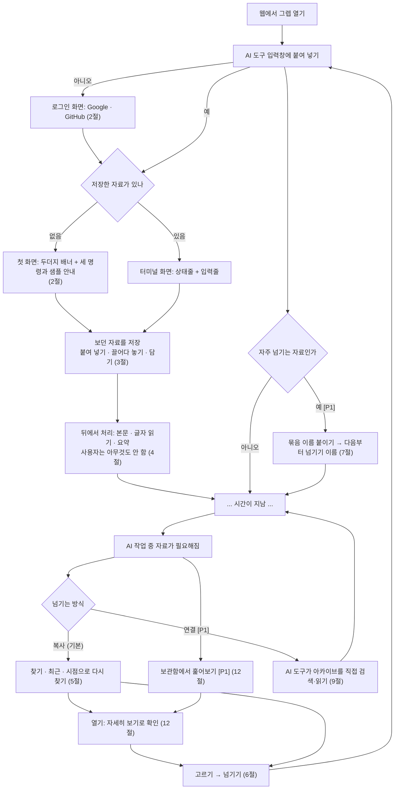

핵심 흐름(데모 성공 기준): 저장해 둔 한국어 자료를 `찾기`로 찾아 AI 도구에 붙여 넣을 글로 복사하기까지 **1분 안**.

## 2. 처음 열 때 (F6a 로그인, F5) [데모]

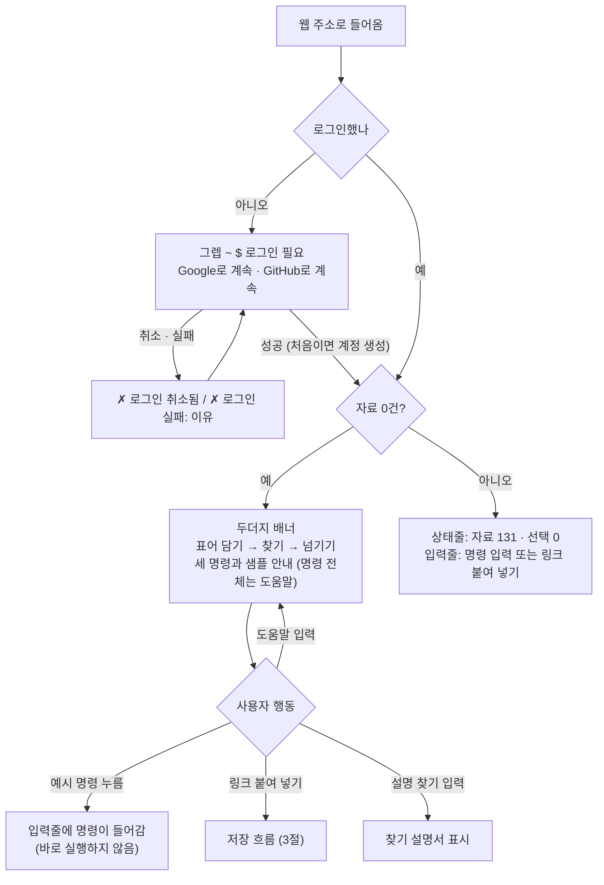

| 단계 | 사용자 | 화면 | 근거 |
|---|---|---|---|
| 0 | 그렙을 처음 연다 | 로그인 화면 `그렙 ~ $ 로그인 필요`, 버튼 `Google로 계속` · `GitHub로 계속`. 로그인 전에는 명령·저장·`도움말`을 받지 않는다 | ACC-001 |
| 1 | 로그인했고 자료가 0건이다 | 두더지 배너, 표어 `담기 → 찾기 → 넘기기`, `· 자료 0건`, `→ 샘플 8건으로 해 보기 또는 아래에 링크 붙여 넣기`, `· 명령 전체: 도움말`. 명령 13줄 표는 보여 주지 않는다 | US-6, commands.md 6절 |
| 2 | 샘플 안내를 누르거나 링크를 붙여 넣는다 | 샘플이면 샘플 8건이 그 계정의 다음 번호 8개(새 계정은 1~8번)로 저장되고, 받은 범위로 `버리기 <a>-<b>`를 쓰면 치울 수 있다고 안내한다. 링크면 저장된다 | US-6, ARC-010 |
| 3 | 무엇을 칠지 모르겠다 | `도움말`(`guide`)로 같은 목록, `설명 <명령>`(`about`)으로 명령별 설명서 | commands.md 2·3절 |

- 계정: 로그인해야 쓴다(ACC-001). Google과 GitHub는 이메일이 같아도 다른 계정이다. 로그인은 30일 동안 쓰지 않거나 로그인한 지 90일이 지나면 만료된다.
- 로그인 만료: `! 로그인 만료 → 다시 로그인`. 입력 중이던 줄은 남아 있다가 다시 로그인하면 돌아온다.
- 로그아웃: `로그아웃`(`signout`)은 이 기기만, `로그아웃 모든기기`는 모든 기기와 AI 도구 연결을 끊는다(다른 기기는 최대 1시간 뒤). 기기 수 제한과 기기 목록은 없다(ACC-002, 나중에 제한).
- 두더지는 첫 화면, 자료가 없을 때, 오래 걸리는 처리에만 나오고 말하지 않는다.

## 3. 저장 (F1, F21) [데모]

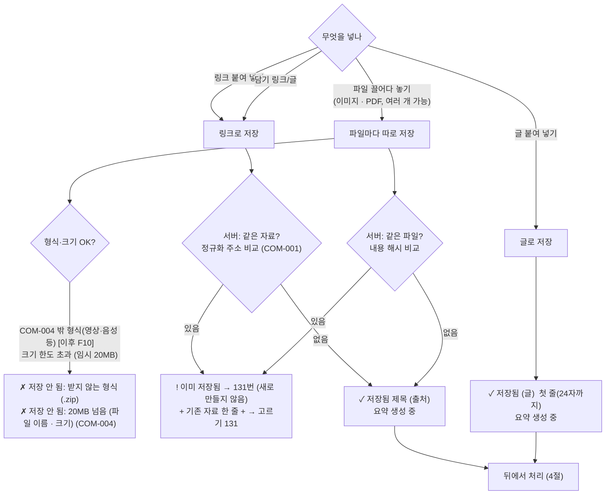

| 단계 | 사용자 | 화면 | 서버 |
|---|---|---|---|
| 1 | 보던 링크를 복사해 입력줄에 붙여 넣는다. 명령은 안 쳐도 된다 | 끌어다 놓는 중에는 `놓으면 저장` / `링크 · 글 · 이미지 · PDF · md · docx`(COM-004) | 멱등성 키로 같은 요청 두 번을 하나로 |
| 2 | 기다리지 않는다 | `✓ 저장됨  카페 텀블러 할인, 올겨울 캠페인 늘었다 (팀 가상 기사)` 뒤에 `요약 생성 중` | 저장 응답은 바로. 처리는 작업 큐로 |
| 3 | 여러 파일을 한 번에 놓았다 | 파일마다 한 줄씩 | 항목별 결과 |
| 4 | 같은 링크를 또 붙여 넣었다(꼬리표 `utm_*`나 끝 `/`만 다른 주소 포함) | `! 이미 저장됨 → 131번 (새로 만들지 않음)`, 기존 자료 한 줄, `→ 고르기 131`. 오류로 보이지 않는다 | 새 자료를 만들지 않고 기존 자료와 그 번호를 돌려줌. 번호를 새로 쓰지 않는다(ARC-001) |

분기:

- 휴지통에 있는 자료와 같으면 `! 휴지통에 있음 → N번. 되살리기 N`으로 알린다. 영구 삭제한 자료와 같은 링크는 새로 저장한다(COM-001 규칙 7).
- 분류(폴더·태그)는 묻지 않는다. 태그는 서버가 자동으로 붙여 목록에 앞 3개를 보여 준다. 사용자는 붙이거나 고치지 못하고 `고치기 <번호> -#태그`로 지우기만 한다(ARC-002). 폴더 역할은 묶음이 한다(7절).
- 새 자료는 서버가 사용자별 고유 번호를 붙인다(1부터, 지운 번호는 다시 쓰지 않음, ARC-001). 목록·고르기·고치기·버리기가 모두 이 번호를 쓴다.
- 로그인이 필요한 SNS 게시물은 링크만으로 본문을 못 가져올 수 있다. 글을 함께 붙여 넣거나 스크린샷을 저장하도록 안내한다(4절).

## 4. 저장한 뒤 처리 (F2, F16) [데모: 요약 / P1: 글자 읽기]

사용자는 아무것도 하지 않는다. 처리 상태는 화면에 그대로 보인다.

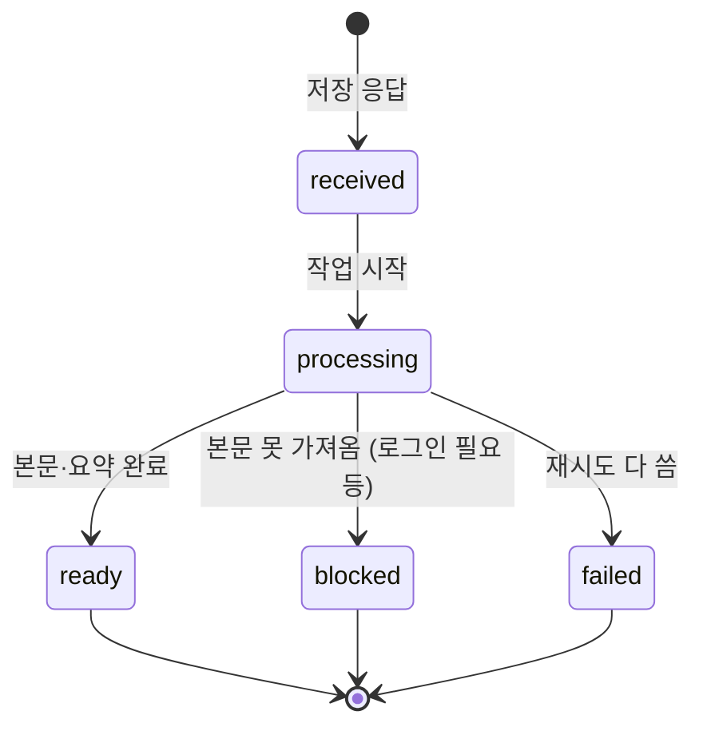

| 상태 | 목록에 보이는 것 | 넘기면 나가는 것 |
|---|---|---|
| received / processing | 제목, 출처, 저장 시각, 요약 자리에 `요약 생성 중`. 상태줄에 `요약 생성 중 1` | 제목과 출처만. 넘길 글에 요약이 없다고 표시 |
| ready | 제목, 출처, 저장 시각, 한 줄 요약, 태그 앞 3개 | 제목, 출처, 저장 시각, 넘기기용 요약 |
| blocked | `! 본문 못 가져옴: 로그인 필요  제목·링크만 저장` | 제목과 출처만 |
| failed | 저장은 그대로 남는다. 요약 자리에 `! 요약 못 만듦  제목·출처만 넘김`(ARC-005) | 제목과 출처만 |

- 하는 일: 웹 본문 가져오기, PDF 글자 추출, 이미지 글자 읽기(F16, 서버 LLM 비전), 요약(서버 소형 LLM), 자동 태그(자료당 최대 5개, ARC-002). 태그를 못 만들어도 따로 알리지 않는다.
- 외부 LLM에는 자료 내용만 허용 제공사의 API로 보낸다. 발표까지는 팀이 만든 자료와 공개 자료만 넣고 무료 플랜을 쓰며, 실제 사용자를 받기 전에 학습에 쓰지 않는 API로 바꾼다. 제공사 장애 때는 다른 제공사로 바꾸지 않고 나중에 다시 시도한다(COM-002).
- 글자가 없는 이미지는 저장 시각과 출처로만 찾을 수 있다고 알린다. 시점으로 찾기(F22)가 있으면 `최근 <시점>`을 안내한다.

## 5. 다시 찾기 (F3, F22) [데모: 찾기·최근 / P1: 시점]

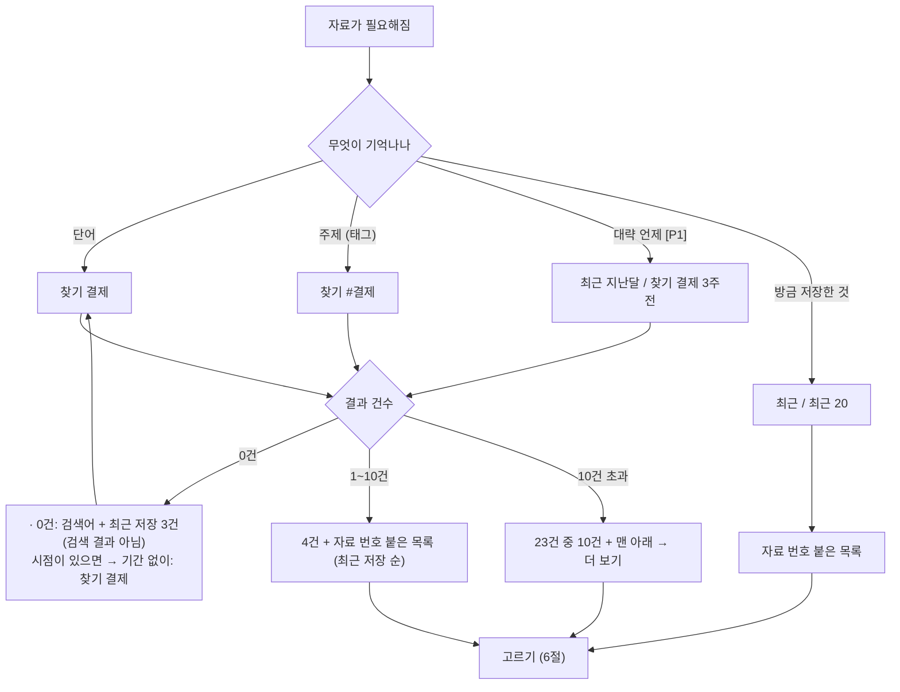

| 단계 | 사용자 | 화면 | 근거 |
|---|---|---|---|
| 1 | `찾기 결제`(`seek 결제`) | 제목·본문·요약·이미지 속 글자·태그에 "결제"가 든 자료. 자료 번호, 제목, 출처, 저장 시각, 한 줄 요약, 태그 앞 3개. 최근 저장 순 | US-3, ARC-001, ARC-002 |
| 1-1 | `찾기 #결제 위젯` | 태그가 정확히 `결제`이고 "위젯"이 든 자료(모든 조건을 만족). 아직 태그가 없는 자료는 나오지 않는다 | ARC-002 |
| 2 | 결과가 많다 | `23건 중 10건`, 맨 아래 `→ 더 보기`(다음 10건) | 10절, commands.md 6절 |
| 3 | 단어는 흐릿하고 시기만 기억난다 | `최근 지난달` → `4건 · 지난달 (10/1~10/31)`, 여러 주면 `── 10/20~10/26 ──` 구분선 | US-13, F22 |
| 4 | 결과가 없다 | `· 0건: "결제"` 뒤에 `· 최근 저장 3건 (검색 결과 아님)`과 3건. 뜻으로 찾기(F15)가 있으면 그 결과를 제안 | 10절 |

틀리게 쳤을 때(공통):

| 입력 | 화면 |
|---|---|
| `찻기 결제` | `✗ 없는 명령: 찻기` → `명령 목록: 도움말`. 가까운 명령 제안(F17, P1)이 있으면 `→ 찾기 결제?` |
| `grep 결제` | `· grep → 찾기 결제로 실행` 뒤에 찾기 결과(commands.md 5절) |
| `찾기`만 | `✗ 검색어 없음  예: 찾기 결제` |
| `찾기 #` | `✗ 태그 없음  예: 찾기 #결제` |
| `찾기 결제 13월` | `✗ 알 수 없는 시점: 13월` 뒤에 `예: 지난주 · 3주전 · 11월` |
| "지난달"이라는 단어를 찾고 싶음 | `찾기 "지난달"`(따옴표) |

## 6. 고르기와 넘기기 (F4) [데모]

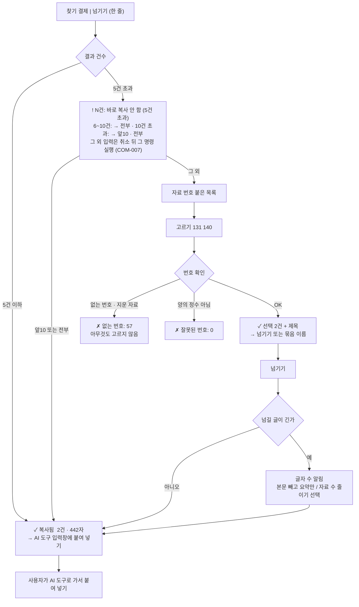

| 단계 | 사용자 | 화면 | 근거 |
|---|---|---|---|
| 1 | 목록에서 `고르기 131 140` | `✓ 선택 2건  <제목> · <제목>`, `→ 넘기기 또는 묶음 <이름>`. 선택된 행에 `▸`, 입력줄 위에 선택 줄, 상태줄 `선택 2`. 목록의 번호를 누르면 `고르기 <번호>`가 찍힌다. 번호는 목록 위치가 아니라 자료 고유 번호라, 바로 앞 목록에 없던 자료도 고를 수 있다 | US-4, ARC-001 |
| 2 | `넘기기` | `✓ 복사됨  2건 · 442자 (제목·출처·저장 시각·요약)`, 넘긴 자료 목록, `· 미리보기: 펼치기`, `· 클립보드에 있음 → AI 도구 입력창에 붙여 넣기`. 무엇이 복사됐는지 목록이 항상 나온다 | US-4, N6 |
| 2-1 | 복사가 안 됨(연결 끊김·응답 없음·서버 오류·클립보드 거부) | `✗ 복사 안 됨: <이유>  선택은 남겨 둠` 다음 줄 `→ 넘기기`. 선택은 그대로 남는다 | commands.md 6절, 2026-11-26 PO 결정 |
| 3 | 쓰던 AI 도구(Claude, ChatGPT 등)에 붙여 넣는다 | 그렙 밖 | 9절 3단계 |
| 한 줄로 | `찾기 결제 \| 넘기기` | 5건 이하면 바로 복사, 넘으면 묻는다 | US-5 |

넘길 글의 내용([넘길 글 형식](handoff-format.md)): 자료마다 제목, 출처(링크), 저장 시각, 넘기기용 요약. 본문은 기본으로 넣지 않고, 넣으면 분량을 알린다. 요약이 없는 자료는 제목과 출처만 넣고 그렇다고 표시한다. 회사 업무용 자료라도 막지 않는다.

## 7. 이름 붙인 묶음 (F12, 폴더 역할) [P1, 데모 되면 1순위]

대화를 새로 시작하거나 AI 도구를 바꿀 때 같은 자료를 다시 고르지 않게 한다. 폴더는 따로 없고 한 단계 묶음이 폴더 역할을 한다(ARC-003).

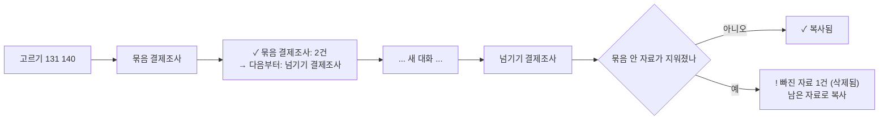

| 하고 싶은 것 | 입력 | 화면 |
|---|---|---|
| 묶음 목록 보기 | `묶음` | `N개 묶음` 뒤에 `<이름>  N건` |
| 묶음 안 자료 보기 | 선택 없이 `묶음 결제조사` | `묶음 결제조사  N건` 뒤에 자료 목록(최근 저장 순) |
| 넣기 | 고른 뒤 `묶음 결제조사` | `✓ 묶음 결제조사: N건`. 이미 있던 자료는 `(이미 있음 M건)` |
| 빼기 | `묶음 결제조사 빼기 140` | `✓ 뺌  묶음 결제조사: N건 남음`. 자료는 지우지 않는다 |
| 묶음 지우기 | `묶음 결제조사 지우기` | `지우기? 묶음 결제조사 (자료 N건은 남음)` 뒤 `→ 실행: 지우기 다시 입력 · 취소: 그 외 입력`(ARC-003) |

- 자료 하나가 여러 묶음에 들어갈 수 있다. 묶음 안에 묶음은 없다.
- 묶음 이름은 사용자 안에서 하나뿐이고, 띄어쓰기 없이 1~20자(한글·영문·숫자·`-`·`_`)다. 숫자만, `#`으로 시작, `빼기`·`지우기`는 이름으로 못 쓴다.
- 묶음 이름 바꾸기는 없다.
- 묶음은 연결 방식에서는 필요가 줄어든다(9절).

## 8. 고치기와 버리기 (F14) [P0]

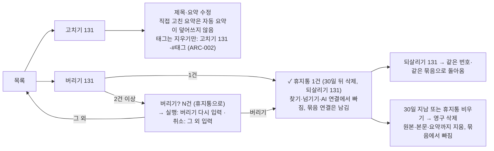

- 지운 자료는 휴지통에 30일 둔다(ARC-008, PO 결정 2026-11-26 재확인).
- 영구 삭제한 자료의 번호는 다시 쓰지 않는다. 그 번호를 다시 치면 `✗ 없는 번호: 131`(ARC-001).

## 9. AI 도구 연결 (F7) [P1, 데모 되면 3순위]

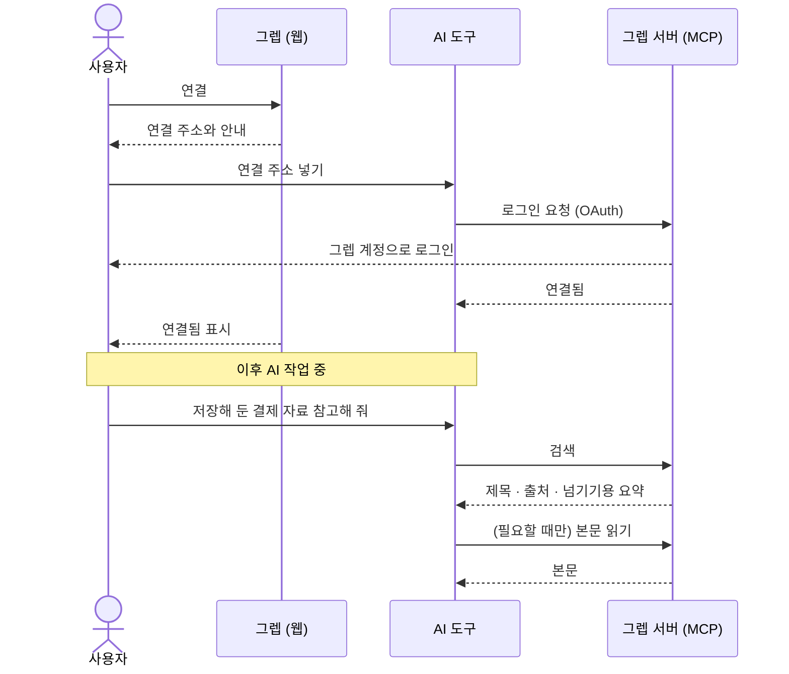

- 읽기 전용이다. AI 도구는 아카이브를 고치거나 지울 수 없다.
- 연결을 지원하지 않는 AI 도구나 요금제면 복사 방식(6절)으로 넘긴다.
- 로그인이 만료되면 AI 도구 쪽에 다시 로그인하라는 안내가 가고, 그렙 화면에도 연결이 끊겼다고 나온다.
- 그렙 계정으로 로그인해 연결한다(ACC-001). `연결`로 연결 목록을 보고 `연결 끊기 <번호>`로 하나씩 끊는다. 끊으면 다음 요청부터 막힌다. `로그아웃 모든기기`도 모든 연결을 끊는다(ACC-002).

## 10. 북마크 가져오기 (F8) [P1, 데모에서 뺌]

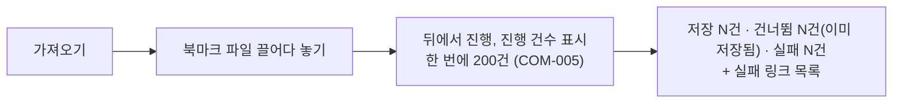

- 가져온 자료는 처음 열거나 넘길 때 요약한다(한꺼번에 요약하지 않음).

## 11. 데모 시나리오 경로 (1분 기준)

발표에서 보여 줄 한 줄기 경로다. 굵은 단계가 데모 필수다. 쓸 자료와 장면별 기대 결과는 [데모 시드 자료](demo-seed.md)에 있다.

| # | 장면 | 입력 | 화면 |
|---|---|---|---|
| 0 | **로그인** | `GitHub로 계속`(데모 계정 A, 자료 0건) | 로그인 뒤 처음 연 화면 |
| 1 | **처음 연 화면** | 없음 | 두더지, 표어, 세 명령과 샘플 안내(누르지 않음) |
| 1-1 | 계정 바꾸기 | `로그아웃` → `Google로 계속`(데모 계정 B, 시드 34건) → `최근` | 로그인 직후 상태줄 `자료 34`와 입력줄만(COM-009), `최근`을 쳐서 목록 |
| 2 | **저장** | PDF 끌어다 놓기(시드 L2) | `✓ 저장됨`, `요약 생성 중`. 요약을 기다리지 않고 다음 장면으로 간다(2026-11-26 PO 결정) |
| 3 | **같은 링크 또 저장** | 같은 링크(꼬리표 붙은 주소, 시드 L1) | `! 이미 저장됨 → N번 (새로 만들지 않음)`(N은 그 자료의 번호) |
| 4 | **찾기** | `찾기 텀블러` → `찾기 텀블러 캠페인` | `8건` → `4건` + 목록 |
| 5 | **고르기·넘기기** | `고르기 <번호> <번호>`(목록에 보이는 자료 번호), `넘기기` | `✓ 복사됨  2건 · N자`(N은 시드를 넣고 실측, demo-seed 5절) |
| 6 | **AI 도구에 붙여 넣기** | AI 도구 입력창 | 자료가 반영된 답 |
| 7 | 되면: 묶음 | `묶음 겨울캠페인` → 새 대화에서 `넘기기 겨울캠페인` | `✓ 복사됨` |
| 8 | 되면: 스크린샷 글자로 찾기 | 스크린샷 저장 뒤 `찾기 <이미지 속 단어>` | 그 스크린샷이 나옴 |
| 9 | 되면: 연결 | AI 도구에서 "저장해 둔 텀블러 캠페인 자료 참고해 줘" | AI 도구가 그렙에서 찾아 씀 |

이야기는 비개발 마케터의 겨울 텀블러 캠페인이다(PO 결정, 2026-11-26). 담기 장면(2~3)은 찾기 앞에 둔다(2026-11-26 PO 결정). 4~5단계를 한 줄(`찾기 텀블러 | 넘기기`)로 보이면 8건이라 바로 복사하지 않고 `→ 전부: 8건 전부 · 취소: 그 외 입력`이 나온다. 시점으로 찾기(F22)를 넣을지는 개발자 답을 기다린다.

## 12. 저장된 자료 보기: 자세히 보기와 보관함 (ARC-011, ARC-007) [자세히 보기 P0 / 보관함 P1]

시안: [그렙 웹 화면 시안](https://claude.ai/artifact/J6XT7UcSDvuPC2quoSsaRm)의 "웹" 페이지 09(터미널의 `열기`)·10(넓은 웹 보관함, 찾기 칸 저장)·11(`찾아두기`), "모바일" 페이지 M6(보관함 탭).

저장한 자료는 세 곳에서 본다. 터미널의 목록 한 줄(5절), 자료 하나를 펼친 **자세히 보기**, 명령 없이 훑어보는 **보관함**이다. 셋 모두 같은 자료 번호(ARC-001)와 같은 선택(ARC-003)을 쓰고, 화면에서 누른 동작은 같은 명령으로 터미널 기록에 남는다. 그래서 보관함은 명령어를 가르치는 길이 된다.

### 12-1. 자세히 보기 [P0]

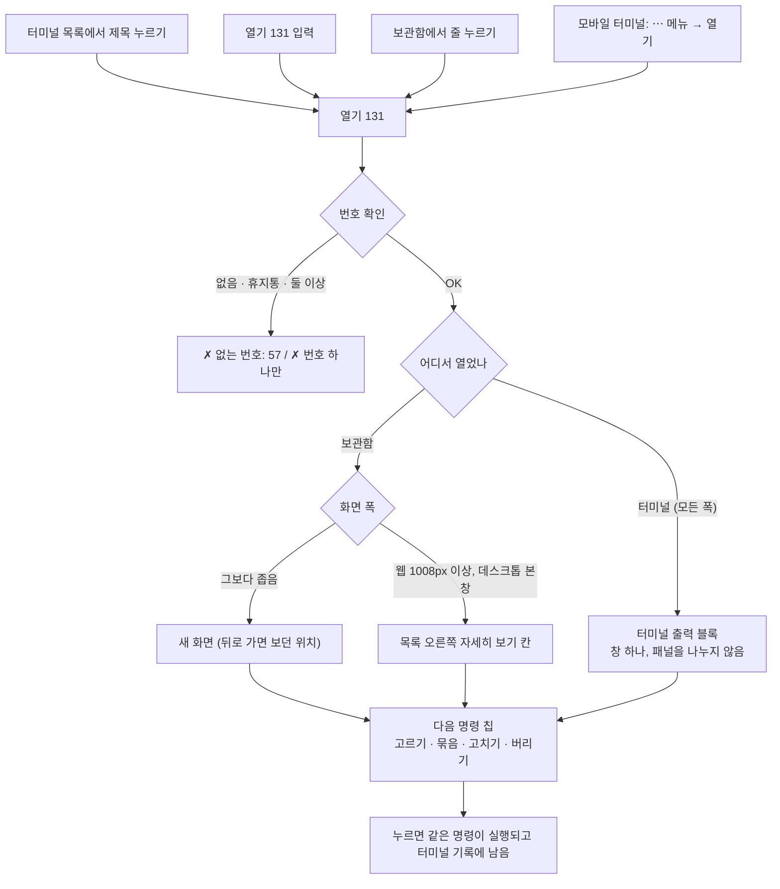

자세히 보기에 나오는 차례(ARC-011 규칙 6):

```text
그렙 ~ $ 열기 131

  131  겨울 음료 트렌드 보고서.pdf
  직접 넣음 · PDF · 저장 2026-11-20 10:42
  AI 요약  겨울 시즌 매장 음료 매출에서 따뜻한 음료 비중이 늘고 …
  태그 (AI 추정)  #겨울캠페인 #음료 #트렌드
  묶음  겨울캠페인
  본문 3,420자  펼치기
  [첫 쪽 미리보기]  원본 열기

  → 고르기 131 또는 묶음 <이름> 또는 고치기 131 또는 버리기 131
```

| 자료 | 출처 줄 | 본문 | 원본 미리보기 |
|---|---|---|---|
| 링크 | 호스트. 누르면 원래 페이지를 새 탭에서 연다 | 접힘. 가져온 웹 본문 | 없음(남의 페이지 그림을 서버가 가져오지 않음) |
| 글 | `직접 넣음 · 글` | 펼침(본문이 곧 원본) | 없음 |
| 이미지 | `직접 넣음 · 이미지` | 접힘. `본문 (이미지에서 읽음)` | 그림 |
| PDF | `직접 넣음 · PDF` | 접힘. 추출한 글자 | 첫 쪽 그림과 `원본 열기` |

처리 상태별(ARC-005): `processing`이면 요약 자리에 회색 `· 요약 생성 중`. 자세히 보기 칸과 모바일 화면은 처리가 끝나면 그 자리만 새로 그리고, 터미널 출력 블록은 연 때 모습 그대로다. `blocked`·`failed`면 `· 본문 없음: 로그인 필요`처럼 이유를 쓰고 다음 명령에 `고치기`를 먼저 둔다.

### 12-2. 보관함 [P1]

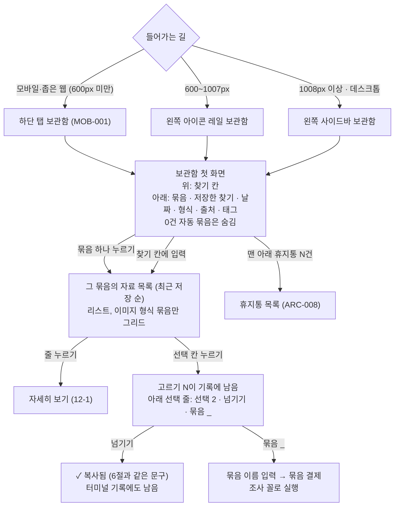

| 단계 | 사용자 | 화면 | 근거 |
|---|---|---|---|
| 1 | 보관함으로 간다 | 맨 위 찾기 칸, 그 아래 구역 차례로 `묶음`(사용자가 만든 것, 0건도 보임), `저장한 찾기`, `날짜`(오늘·이번 주·이번 달·그 전), `형식`(링크·글·이미지·파일), `출처`(호스트, 링크 아닌 것은 `직접 넣음`), `태그 (AI 추정)`. 구역마다 이름과 건수 | ARC-007 |
| 2 | 묶음 하나를 누른다 | 머리줄 `형식: 이미지  7건`, 자료 목록. 줄마다 선택 칸, 번호, 제목, 출처, 저장 시각, 흐린 요약 한 줄. 이미지 형식 묶음은 그림 격자 | ARC-007 규칙 9 |
| 3 | 자료 하나가 궁금하다 | 줄을 누르면 자세히 보기. 1008px 이상은 목록 오른쪽 칸, 좁으면 새 화면(뒤로 가면 보던 위치) | ARC-011 |
| 4 | 몇 개 골라 넘긴다 | 선택 칸을 누를 때마다 기록에 `고르기 N`. 아래 선택 줄 `선택 2 · 넘기기 · 묶음 _`. 모바일은 고르는 동안 하단 탭이 숨는다 | MOB-001 규칙 4·7 |
| 5 | 터미널로 돌아간다 | 선택이 그대로 있다. 보관함에서 한 동작이 명령으로 기록에 있다 | MOB-001 규칙 6·7 |

- 저장한 찾기(ARC-012): 찾기 칸 결과 머리줄의 `이 찾기 저장`을 누르면 `찾아두기 <검색어>`가 실행된다. 이미 저장된 검색어면 버튼 자리에 `저장한 찾기`. 저장한 찾기 하나를 열면 머리줄에 `지우기`(확인 뒤 저장한 찾기만 지움). 터미널에서는 `찾기` 결과 다음 명령 칩에 `찾아두기 <검색어>`가 붙고, `찾아두기`만 치면 목록이 나온다. 0건인 저장한 찾기는 보관함에서 숨고 터미널 목록에는 보인다.
- 보관함에서는 자동 묶음을 만들거나 고치거나 자료를 옮기지 않는다. 폴더 만들기 컨트롤도 없다(ARC-007 규칙 1·3).
- 보관함이 비었으면(자료 0건) 묶음 구역만 보이고, 두더지와 `→ 터미널에서 샘플 8건으로 해 보기`를 보여 준다.

### 12-3. 넓은 웹과 데스크톱 배치 (제안, 폭 값은 개발자가 정함)

| 폭 | 배치 | 자세히 보기 |
|---|---|---|
| 600px 미만 | 하단 탭 터미널 · 보관함 · 설정(MOB-001) | 새 화면(모바일), 터미널 출력 블록(좁은 웹 터미널) |
| 600~1007px | 왼쪽 아이콘 레일(터미널 · 보관함 · 설정) + 고른 화면 | 보관함에서는 새 화면, 터미널에서는 출력 블록 |
| 1008px 이상, 데스크톱 본창 | 왼쪽 사이드바(터미널 · 보관함 · 묶음 이름 목록, 맨 아래 설정) + 고른 화면 | 보관함에서는 목록 오른쪽 칸, 터미널에서는 출력 블록 |

- 사이드바·레일은 화면(터미널·보관함·설정)을 오가는 길일 뿐이고, 터미널 창 안을 나누지 않는다. 터미널 화면은 넓어도 창 하나다(디자인 시스템 1절 원칙 1).
- 시작 화면은 늘 터미널이다(MOB-001 규칙 3과 같게).
- 사이드바의 묶음 이름을 누르면 `묶음 <이름>`이 실행된다(터미널 결과로 보여 줌).
- 데스크톱 빠른 창(DSK-003)은 좁아서 사이드바와 자세히 보기 칸이 없다.

## 13. 이 흐름에 없는 것과 정하지 않은 것

| 항목 | 상태 |
|---|---|
| 크기 한도를 넘는 파일의 화면 문구 | 정함: `✗ 저장 안 됨: 20MB 넘음 (<파일 이름> · <크기>)`(COM-004). 한도 값 20MB는 아직 임시값(공통 영역 열린 질문) |
| 휴대폰 공유로 저장, 명령어 버튼(US-7) | 모바일 앱 단계 |
| 저장한 걸 잊었을 때 그렙이 먼저 알려 주기(원인 후보 N7, 작업 이름으로 모으기 F20, 브라우저 확장 F11) | 발표의 "다음 단계". 이 문서의 흐름은 모두 사용자가 기억해서 그렙을 여는 것에서 시작한다 |
| 여러 기기 동기화(F6), 인터넷 없을 때 저장(F18) | P1·이후. 인터넷이 없으면 저장과 찾기가 안 된다고 알린다 |
| 기기 수 제한, 기기 목록 | 지금은 없음. 나중에 제한을 건다(ACC-002 비고) |
| 회원 탈퇴 | 발표 뒤 결정(계정 영역 열린 질문) |
| 뜻으로 찾기(F15) | P1, 데모에서 뺌. 0건일 때 제안으로만 등장 |
| 휴지통 명령 이름(`휴지통`, `되살리기`) | 개발자 확인 뒤 도움말에 더함(ARC-008) |
| 넓은 웹 배치의 폭 값과 레일·사이드바 전환 | 12-3절 제안. 개발자가 정한다 |
